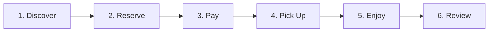

# AGENTS.md — Authoritative Agent Development & Governance Guide

> **CRITICAL RULE**: The repository is the sole source of truth.
> Conversational memory, external assumptions, and previous chat context MUST NOT override repository documentation.
> Every agent must read this document and `docs/PROJECT_STATUS.md` before taking any action.

---

## 1. Project Identity

| Property | Value |
| :--- | :--- |
| **Project Name** | Loqme |
| **Persian Brand** | لقمه |
| **Official Latin Spelling** | Loqme |
| **Official Domain** | [loqme.shop](https://loqme.shop) |
| **Repository Path** | `C:\Users\etraab\.gemini\antigravity-ide\scratch\loqme` |

---

## 2. Product Definition

**Loqme** is a Persian-first, hyper-local marketplace for discovering and purchasing safe, legally sellable, surplus or time-sensitive inventory from approved local businesses at attractive, discounted prices.

### What Loqme IS NOT:
* **NOT** an expired-product marketplace (expired does NOT mean discounted).
* **NOT** a garbage / leftover marketplace (never sell plate waste or discarded food).
* **NOT** merely a restaurant ordering or delivery clone (we focus on scheduled surplus pickup).
* **NOT** a generic coupon / voucher website.
* **NOT** an environmental NGO or charity platform (we are a sustainable commercial marketplace driven by value and discovery).

---

## 3. Product Psychology & Emotional Hierarchy

The customer emotional journey is anchored in pride, discovery, and smart value:

1. **Primary Emotion**: **DISCOVERY** (هیجان کشف خوراکی‌ها و بسته‌های تازه)
2. **Secondary Emotion**: **VALUE** (ارزش اقتصادی ملموس و کیفیت بالا)
3. **Third Emotion**: **SMART SAVING** (حس رضایت از خرید هوشمندانه)
4. **Fourth Emotion**: **TRUST** (اطمینان به سلامت، بهداشت و شفافیت فروشگاه)

> **Sustainability is positive secondary reinforcement, NOT the primary hook.**
> 
> The customer must always feel:  
> **“I found something great at an unbelievable price.”**  
> Never:  
> *“I bought something nobody wanted or felt guilty about.”*

---

## 4. Core Product Loop

1. **Discover**: Browse nearby bakeries, cafes, markets, and restaurants offering surplus listings (Surprise Bags & Flash Deals) with pickup time windows.
2. **Reserve**: Temporary inventory lock (10–15 min countdown) during checkout.
3. **Pay**: Secure online checkout via integrated Iranian payment gateway abstraction.
4. **Pick Up**: Present dynamic QR code or OTP to the merchant during the designated pickup window.
5. **Enjoy**: Customer consumes fresh, high-quality surplus food at a fraction of the retail cost.
6. **Review**: Rate merchant quality, punctuality, and bag value to maintain high trust and social proof.

---

## 5. Merchant Value Proposition

* **Monetize Unsold Inventory**: Convert end-of-day or surplus stock that would otherwise be discarded into immediate gross margin and cash flow.
* **Customer Acquisition**: Drive new neighborhood foot traffic directly into brick-and-mortar stores without upfront advertising spend.
* **No Artificial Surplus**: The platform does NOT encourage intentional overproduction. It exists solely to optimize legitimate variance in daily demand.

---

## 6. Safety & Quality Directives

> [!CAUTION]
> **Expired does NOT mean discounted.**
> Loqme maintains zero tolerance for compromised food safety.

Never facilitate, list, or transact:
1. **Expired products** (محصولات تاریخ انقضا گذشته تحت هر شرایطی ممنوع هستند).
2. **Unsafe or spoiled products** (هرگونه تغییر بو، رنگ، بافت یا علائم فساد).
3. **Previously served food** (غذای باقی‌مانده از میز مشتری، سلف‌سرویس باز یا ظروف دست‌خورده).
4. **Food with unknown handling or broken cold chain** (زنجیره دمایی نامشخص).
5. **Damaged, unsealed, or bloated packaging** (بسته‌بندی باز، بادکرده یا فاقد مجوز بهداشتی).
6. **Prohibited categories** (شیر خام غیرپاستوریزه، گوشت و غذای دریایی خام بدون بسته‌بندی شناسنامه‌دار، غذاهای خانگی فاقد پروانه بهداشت).

Refer to [FOOD_SAFETY.md](file:///C:/Users/etraab/.gemini/antigravity-ide/scratch/loqme/docs/FOOD_SAFETY.md) for full policy and state transitions.

---

## 7. Architecture Guidelines & Multi-Client Protocol

> [!IMPORTANT]
> **Multi-Client Architecture Principle**:
> Loqme is a multi-client product. Web is the first client, but Mobile (Native iOS & Android via React Native/Expo) is a planned first-class client.
> New architecture must not unnecessarily couple domain/business logic to Web-only technologies.
> 
> * **Backend Authority**: Never duplicate authoritative business rules, pricing calculations, inventory reservations, or security evaluations between Web and Mobile. The backend remains the sole source of truth.
> * **Separation of Utilities**: Before creating a new shared utility, determine whether it belongs to the backend, shared package (`packages/*`), web client (`apps/web`), or future mobile client (`apps/mobile`).
> * **Zero Web-Only Dependencies in Shared**: Never introduce Web-only dependencies (`window`, `document`, `localStorage`, `sessionStorage`, Next.js components) into shared packages (`packages/types`, `packages/validation`, `packages/design-tokens`, `packages/api`).

* **Target Stack**:
  * **Monorepo Structure**: npm workspaces with `apps/*` and `packages/*`
  * **Web Client**: Next.js 14 (App Router), React 18, TypeScript 5 in `apps/web`
  * **Future Mobile Client**: React Native / Expo in `apps/mobile` (consuming shared packages)
  * **Shared Contracts**: `@loqme/types`, `@loqme/validation`, `@loqme/design-tokens`, `@loqme/api` in `packages/*`
  * **Database**: PostgreSQL 15 with PostGIS extension for geospatial radius queries (`ST_DWithin`, `ST_Distance`)
  * **Styling**: Centralized Token System in `@loqme/design-tokens` (CSS variables for Web, StyleSheet tokens for Mobile, Vazirmatn typography)
* **Separation of Concerns**:
  * Keep business and transaction logic strictly outside React UI components.
  * Use Domain Services (`ListingService`, `OrderService`, `PaymentService`, `PickupService`).
  * Abstraction layers for Payment, SMS/OTP, Geocoding/Maps, and Storage.
* **Prohibited MVP Architectures**:
  * Do **NOT** build a WebView-in-a-box or PWA wrapper for the mobile application. Mobile is native React Native/Expo.
  * Do **NOT** introduce a separate .NET backend or Java Spring microservices for MVP unless justified by existing repository constraints.
  * Do **NOT** introduce distributed event brokers (Kafka, RabbitMQ) prior to reaching documented scalability thresholds.

Refer to [ARCHITECTURE.md](file:///C:/Users/etraab/.gemini/antigravity-ide/scratch/loqme/docs/ARCHITECTURE.md), [MOBILE_ARCHITECTURE.md](file:///C:/Users/etraab/.gemini/antigravity-ide/scratch/loqme/docs/MOBILE_ARCHITECTURE.md), and [ADR-001](file:///C:/Users/etraab/.gemini/antigravity-ide/scratch/loqme/docs/decisions/ADR-001-mobile-architecture.md).

---

## 8. Localization & Regional Conventions

* **Primary Locale**: `fa-IR` (فارسی)
* **Direction**: Right-to-Left (`dir="rtl"`) throughout all user, merchant, and admin interfaces.
* **Currency**: **Toman** (تومان) displayed with Persian numerals and thousands separators (e.g. `۲۵,۰۰۰ تومان`).
* **Calendar**: **Jalali (Solar Hijri / خورشیدی)** for all customer-facing dates, pickup windows, and operational schedules.
* **Phone Numbers**: Iranian standard format (`09xxxxxxxxx` or `+989xxxxxxxxx`).
* **Typography**: **Vazirmatn** (open-source OFL licensed). Never use unlicensed proprietary fonts or assets.

Refer to [DESIGN_SYSTEM.md](file:///C:/Users/etraab/.gemini/antigravity-ide/scratch/loqme/docs/DESIGN_SYSTEM.md).

---

## 9. Visual & Interaction Design

* **Brand Vibe**: Modern, Friendly, Trustworthy, Fresh, Calm, Discovery-oriented.
* **Color Palette (White + Teal / Dark Turquoise — سبز کله‌غازی)**:
  * Pure white canvas foundation (`#FFFFFF` dominant 70–85% of visual area).
  * Sophisticated dark turquoise / deep teal brand energy (`#0F766E` / `#115E59` / `#0D9488`).
  * Restrained emerald for safety and verified badges (`#10B981` / `#059669`).
  * Deep slate charcoal typography (`#0F172A` / `#1E293B`).
  * Soft teal tint (`#F0FDFA`) for subtle selection and soft backgrounds.
* **Forbidden Design Patterns**:
  * Avoid white + orange dominance.
  * Avoid generic eco/green guilt branding.
  * Avoid cheap coupon-clipping aesthetics.
  * Avoid dark patterns (fake countdowns, non-existent urgency, fabricated viewer counts).

Refer to [BRAND.md](file:///C:/Users/etraab/.gemini/antigravity-ide/scratch/loqme/docs/BRAND.md) and [DESIGN_SYSTEM.md](file:///C:/Users/etraab/.gemini/antigravity-ide/scratch/loqme/docs/DESIGN_SYSTEM.md).

---

## 10. Security & Authority Boundaries

> [!IMPORTANT]
> **Never trust client-provided data for financial or stateful operations.**

1. **Client Untrusted**: Prices, discount percentages, inventory counts, commission cuts, payment states, user roles, and merchant ownership MUST be determined server-side.
2. **Role-Based Access Control (RBAC)**: Strict enforcement across `CUSTOMER`, `MERCHANT_STAFF`, `MERCHANT_OWNER`, and `ADMIN`.
3. **Financial Concurrency**: Pessimistic locking or atomic decrement for inventory reservations; idempotency keys for payment initiations and callbacks.
4. **Zero Secrets in Source**: All API keys, DB credentials, SMS tokens, and gateway secrets must live in environment variables.

Refer to [SECURITY.md](file:///C:/Users/etraab/.gemini/antigravity-ide/scratch/loqme/docs/SECURITY.md).

---

## 11. Milestone Governance & Agent Protocol

Every agent working on this repository **MUST** follow this strict protocol:

1. **Read `AGENTS.md`** (this file).
2. **Read `docs/PROJECT_STATUS.md`** to verify current milestone and open risks.
3. **Read `docs/ROADMAP.md`** and the specific milestone file in `docs/milestones/`.
4. **Inspect existing implementation** — never assume state from conversational memory.
5. **Implement ONLY the scope defined in the current milestone checkpoint.**
6. **Run automated tests and validation.**
7. **Update `docs/PROJECT_STATUS.md`** with exact completed checkpoints, test results, and next actions.
8. **Update the milestone file's Checkpoint section.**
9. **Update domain documentation** if any architecture or product decision evolved.

### Completion Truth Table:
* Creating a branch is **NOT** completion.
* Writing a plan is **NOT** completion.
* Generating a boilerplate scaffold is **NOT** completion.
* Work is complete **ONLY** when code is implemented, tests pass, and repository documentation reflects reality.

---

## 12. Complete Documentation Directory Map

| Document | Purpose |
| :--- | :--- |
| [README.md](file:///C:/Users/etraab/.gemini/antigravity-ide/scratch/loqme/README.md) | Repository overview & local developer onboarding |
| [PRODUCT.md](file:///C:/Users/etraab/.gemini/antigravity-ide/scratch/loqme/docs/PRODUCT.md) | Comprehensive product requirements, user flows & personas |
| [PRODUCT_PRINCIPLES.md](file:///C:/Users/etraab/.gemini/antigravity-ide/scratch/loqme/docs/PRODUCT_PRINCIPLES.md) | 15 unalterable product principles & behavioral bounds |
| [UX_PSYCHOLOGY.md](file:///C:/Users/etraab/.gemini/antigravity-ide/scratch/loqme/docs/UX_PSYCHOLOGY.md) | Cognitive framing, habit loops, trust & anti-manipulation |
| [BRAND.md](file:///C:/Users/etraab/.gemini/antigravity-ide/scratch/loqme/docs/BRAND.md) | Brand voice, tone, messaging, visual guide & font rules |
| [DESIGN_SYSTEM.md](file:///C:/Users/etraab/.gemini/antigravity-ide/scratch/loqme/docs/DESIGN_SYSTEM.md) | Centralized token architecture, RTL components & accessibility |
| [ARCHITECTURE.md](file:///C:/Users/etraab/.gemini/antigravity-ide/scratch/loqme/docs/ARCHITECTURE.md) | Technical architecture, domain services, layers & abstractions |
| [DATA_MODEL.md](file:///C:/Users/etraab/.gemini/antigravity-ide/scratch/loqme/docs/DATA_MODEL.md) | Conceptual & relational domain entities, relations & lifecycle |
| [BUSINESS_MODEL.md](file:///C:/Users/etraab/.gemini/antigravity-ide/scratch/loqme/docs/BUSINESS_MODEL.md) | Commission mechanics, unit economics & marketplace flywheel |
| [SECURITY.md](file:///C:/Users/etraab/.gemini/antigravity-ide/scratch/loqme/docs/SECURITY.md) | Auth, RBAC, payment security, concurrency & audit trail |
| [FOOD_SAFETY.md](file:///C:/Users/etraab/.gemini/antigravity-ide/scratch/loqme/docs/FOOD_SAFETY.md) | Safety status state machine, inspection rules & disclaimers |
| [LEGAL_ASSUMPTIONS.md](file:///C:/Users/etraab/.gemini/antigravity-ide/scratch/loqme/docs/LEGAL_ASSUMPTIONS.md) | Legal assumption registry, E-commerce law & guild validation |
| [ROADMAP.md](file:///C:/Users/etraab/.gemini/antigravity-ide/scratch/loqme/docs/ROADMAP.md) | M00 through M11 roadmap breakdown |
| [PROJECT_STATUS.md](file:///C:/Users/etraab/.gemini/antigravity-ide/scratch/loqme/docs/PROJECT_STATUS.md) | Living status tracker: current milestone, checkpoints & risks |
| [Milestones](file:///C:/Users/etraab/.gemini/antigravity-ide/scratch/loqme/docs/milestones) | Specifications M00 through M11 |
