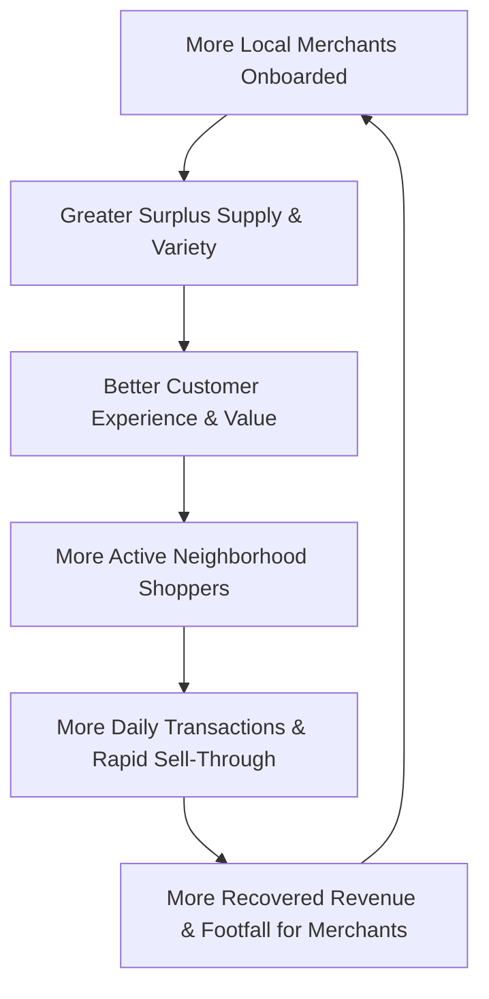

# Business Model & Economics — Loqme (لقمه)

> **Core Philosophy**: Symbiotic, win-win commercial marketplace driving sustainable neighborhood profitability.

---

## 1. Initial Revenue Model: Transaction Commission

Loqme launches with a straightforward, transparent performance-based model:
* **Zero Onboarding Fee**: No setup fee for partner merchants to join.
* **Zero Monthly Fee for MVP**: Merchants only pay when surplus inventory successfully sells.
* **Default Platform Commission**: **10%** of Gross Merchandise Value (GMV).
* **Configurable Rule Engine**: Commission is configurable per category (e.g. 8% for high-volume grocery vs 12% for artisanal cafes) or negotiated per merchant contract.

---

## 2. Core Economic Metrics & Mechanics

### 2.1 Gross Merchandise Value (GMV)
Total transaction value processed through the Loqme platform before any deductions.
$$\text{GMV} = \sum (\text{Discounted Bag Price} \times \text{Quantity Sold})$$

### 2.2 Platform Commission
The revenue captured by Loqme for providing demand matching, technology, payment routing, and customer support.
$$\text{Commission} = \text{GMV} \times \text{Commission Rate (e.g. 10\%)}$$

### 2.3 Merchant Net Payout
The net funds remitted to the partner business bank account (via automated Paya transfer) on a bi-weekly settlement cycle.
$$\text{Merchant Payout} = \text{GMV} - \text{Commission} - \text{Approved Refunds}$$

### 2.4 Average Order Value (AOV)
Target AOV for MVP is calibrated to urban Iranian consumer purchasing patterns:
* **Surprise Bag Sweet Spot**: `۶۰,۰۰۰ تومان` to `۱۲۰,۰۰۰ تومان` (representing standard retail value of `۱۵۰,۰۰۰ تومان` to `۳۰۰,۰۰۰ تومان`).
* **Flash Deals**: `۴۰,۰۰۰ تومان` to `۱۸۰,۰۰۰ تومان`.

### 2.5 Sell-Through Rate (نرخ فروش موفق مازاد)
The percentage of published surplus units successfully purchased and picked up before the daily pickup window closes:
$$\text{Sell-Through Rate} = \frac{\text{Completed Pickups}}{\text{Total Published Listings}} \times 100$$
Target benchmark: **> 85%** in high-density districts.

### 2.6 Refund Handling & Economics
* In cases of merchant default (store closed, spoiled items, refusal to fulfill), the customer receives a **100% full refund**.
* The merchant bears the cost of the refund, plus a nominal platform processing fee to discourage repeated operational failures.

---

## 3. The Marketplace Flywheel

* **Density Driver**: When a single neighborhood has 10–15 participating stores (bakeries, cafes, delis), consumer habit solidifies.
* **Foot Traffic Value**: Beyond the direct payout on surplus, merchants acquire new neighborhood customers who frequently make supplementary full-price purchases during pickup.

---

## 4. Future Monetization Streams (Post-MVP)

1. **Merchant Subscription Tiers (Loqme Pro)**:
   * Premium analytics, customer retention metrics, automated daily drop scheduling, and priority push notification placement.
2. **Promoted Listings & Sponsored Drops**:
   * Paid spotlight placement in the "Featured Discoveries" carousel for newly opened cafes or special seasonal surplus campaigns.
3. **Analytics & Surplus Reduction SaaS**:
   * Offering large franchise bakeries and supermarket chains predictive production planning tools to optimize bake sizes and reduce baseline waste.
4. **Dynamic Pricing Engine**:
   * Algorithmic discount adjustments (e.g. starting at 40% discount at 18:00, ramping up to 65% discount 30 minutes before closing).
5. **Enterprise B2B Surplus Exchange**:
   * Brokering pallet-level near-date bulk inventory between food manufacturers/distributors and institutional kitchens or budget grocers.

## CP-11.9 financial reporting correction (2026-10-03)

Order commission and merchant payout are agreed and stored at checkout. Later changes to a merchant's commission rate must not recalculate historical dashboard or settlement amounts; zero commission is valid. Financial reports now sum those stored values. Merchant transaction rows represent customer payment transfers and the customer-facing refund transfer, rather than applying another commission to each internal clearing entry. Refund amounts are negative in that statement.

No persisted bank-account verification model exists yet. APIs now return a missing bank account and an unverified state; the UI must not substitute a sample IBAN or claim verification. Account registration/verification and actual payout-provider acceptance remain release requirements. Automated refunds currently support full-order reversal only; unsupported provider refund operations fail explicitly.
