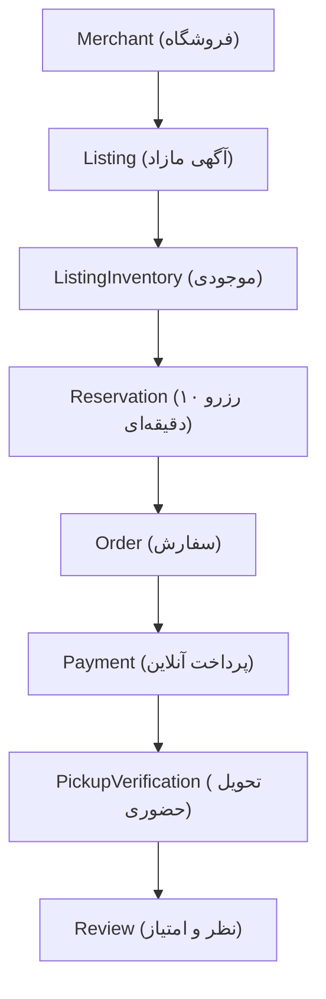

# Conceptual Domain & Data Model — Loqme (لقمه)

> **Document Status**: Authoritative Domain & Entity Specification  
> **Database Engine**: PostgreSQL 15+ with PostGIS  

---

## 1. Core Lifecycle Entity Relationship Flow

---

## 2. Comprehensive Entity Registry

### 2.1 Identity, Roles & Users
* **User**: Base account record.
  * Fields: `id` (UUID), `mobile` (Unique, Iranian 09...), `passwordHash` (Optional/Nullable if OTP-only), `isActive` (Boolean), `createdAt`, `updatedAt`.
* **Role**: System permissions enum:
  * Values: `CUSTOMER`, `MERCHANT_STAFF`, `MERCHANT_OWNER`, `ADMIN`.
* **Customer**: Consumer profile.
  * Fields: `id`, `userId` (FK -> User, Unique), `fullName`, `email` (Optional), `cumulativeSavingsToman` (BigInt), `createdAt`.
* **Merchant**: Partner business entity.
  * Fields: `id`, `ownerUserId` (FK -> User), `businessNameFa`, `businessType` (BAKERY, CAFE, RESTAURANT, SUPERMARKET, DELI, PRODUCE), `licenseNumber` (جواز کسب), `verificationStatus` (PENDING, APPROVED, SUSPENDED, REJECTED), `commissionPercent` (Decimal, default 10.0), `ratingAverage` (Float), `ratingCount` (Int), `createdAt`.
* **MerchantStaff**: Store employees authorized to verify pickups.
  * Fields: `id`, `merchantId` (FK -> Merchant), `userId` (FK -> User), `role` (OWNER, MANAGER, CASHIER), `canScanPickup` (Boolean), `createdAt`.

### 2.2 Geography & Location
* **Province (استان)**: `id`, `nameFa` (e.g. تهران), `slug`.
* **City (شهر)**: `id`, `provinceId` (FK), `nameFa` (e.g. تهران), `slug`.
* **Neighborhood (محله)**: `id`, `cityId` (FK), `nameFa` (e.g. سعادت‌آباد, صادقیه), `slug`, `centerLat`, `centerLng`.
* **MerchantLocation**: Physical brick-and-mortar storefront.
  * Fields: `id`, `merchantId` (FK -> Merchant), `cityId` (FK), `neighborhoodId` (FK), `addressFa`, `postalCode`, `latitude` (Float), `longitude` (Float), `geom` (PostGIS Geography Point), `phone`, `createdAt`.
* **MerchantHours**: Operational and pickup schedule.
  * Fields: `id`, `merchantLocationId` (FK), `dayOfWeek` (0-6, Sat-Fri), `isOpen` (Boolean), `storeOpenTime` (Time), `storeCloseTime` (Time), `defaultPickupStart` (Time), `defaultPickupEnd` (Time).

### 2.3 Catalog, Listings & Inventory
* **Category**: Food categories.
  * Fields: `id`, `slug`, `nameFa` (e.g. نان و شیرینی, نوشیدنی و کافه), `iconUrl`, `parentId` (Self FK, Nullable).
* **Listing**: The core surplus offering.
  * Fields: `id`, `merchantId` (FK), `categoryId` (FK), `type` (SURPRISE_BAG, FLASH_DEAL), `titleFa`, `descriptionFa`, `originalPriceToman` (BigInt), `discountedPriceToman` (BigInt), `pickupDate` (Date), `pickupStart` (Timestamp), `pickupEnd` (Timestamp), `status` (DRAFT, PUBLISHED, PAUSED, SOLD_OUT, EXPIRED), `createdAt`.
* **ListingImage**: Visual assets.
  * Fields: `id`, `listingId` (FK), `imageUrl`, `displayOrder` (Int), `isPrimary` (Boolean).
* **ListingInventory**: High-concurrency inventory tracking.
  * Fields: `id`, `listingId` (FK, Unique), `totalQuantity` (Int), `reservedQuantity` (Int), `soldQuantity` (Int), `version` (Int for optimistic locking).
* **ListingSafety**: Safety, hygiene, and allergen metadata.
  * Fields: `id`, `listingId` (FK, Unique), `safetyStatus` (PENDING_REVIEW, APPROVED, RESTRICTED, REJECTED, UNSAFE, EXPIRED), `allergens` (Array: GLUTEN, DAIRY, NUTS, EGGS, SOY), `dietaryTags` (Array: VEGETARIAN, VEGAN, HALAL), `storageInstructionsFa`, `temperatureRequirement` (ROOM_TEMP, CHILLED, FROZEN).
* **ListingAttributes**: Dynamic JSON attributes (e.g., package weight estimate, vegetarian flag).
  * Fields: `id`, `listingId` (FK), `key`, `valueJson`.
* **PriceHistory**: Price audit trail.
  * Fields: `id`, `listingId` (FK), `originalPriceToman`, `discountedPriceToman`, `recordedAt`.

### 2.4 Reservations, Orders & Transactions
* **Reservation**: Temporary cart hold preventing overselling.
  * Fields: `id`, `listingId` (FK), `customerId` (FK), `quantity` (Int), `expiresAt` (Timestamp, e.g. +10 mins), `status` (PENDING, CONVERTED_TO_ORDER, EXPIRED, RELEASED), `createdAt`.
* **Order**: Confirmed transaction record.
  * Fields: `id`, `orderNumber` (Unique Human Code, e.g. `LQ-10492`), `customerId` (FK), `merchantId` (FK), `reservationId` (FK, Unique), `status` (PENDING_PAYMENT, PAID, READY_FOR_PICKUP, COMPLETED, CANCELLED, REFUNDED, NO_SHOW), `totalAmountToman` (BigInt), `commissionPercent` (Decimal), `commissionAmountToman` (BigInt), `merchantPayoutAmountToman` (BigInt), `createdAt`, `updatedAt`.
* **OrderItem**: Line items.
  * Fields: `id`, `orderId` (FK), `listingId` (FK), `unitPriceToman` (BigInt), `quantity` (Int), `subtotalToman` (BigInt).
* **Payment**: Gateway interaction.
  * Fields: `id`, `orderId` (FK), `gateway` (ZARINPAL, SAMAN, SADAD, MOCK), `authority` (Gateway token), `trackingCode` (String), `referenceId` (String), `amountToman` (BigInt), `status` (INITIATED, SUCCESS, FAILED, REFUNDED), `createdAt`.
* **PaymentEvent**: Raw webhook and callback logs for audit.
  * Fields: `id`, `paymentId` (FK), `eventType`, `payloadJson`, `ipAddress`, `createdAt`.
* **Refund**: Money reversal record.
  * Fields: `id`, `paymentId` (FK), `orderId` (FK), `amountToman` (BigInt), `reasonFa`, `status` (REQUESTED, APPROVED, SETTLED, REJECTED), `processedByUserId` (FK), `createdAt`.

### 2.5 Pickup, Verification & Trust
* **PickupVerification**: Physical handoff handshake.
  * Fields: `id`, `orderId` (FK, Unique), `qrCodeHash` (Cryptographic dynamic token), `otpCode` (4-digit numerical string), `isVerified` (Boolean), `verifiedAt` (Timestamp), `verifiedByStaffId` (FK -> MerchantStaff, Nullable), `attemptCount` (Int), `createdAt`.
* **Review**: Customer feedback loop.
  * Fields: `id`, `orderId` (FK, Unique), `customerId` (FK), `merchantId` (FK), `ratingScore` (Int 1-5), `foodQualityScore` (Int 1-5), `valueScore` (Int 1-5), `commentFa`, `isPublic` (Boolean), `merchantReplyFa`, `createdAt`.
* **Complaint**: Dispute and safety alert.
  * Fields: `id`, `orderId` (FK), `customerId` (FK), `category` (EXPIRED_FOOD, SPOILED_FOOD, STORE_CLOSED, VALUE_DEFICIT, WRONG_ITEMS), `descriptionFa`, `evidenceImageUrls` (Array), `status` (OPEN, INVESTIGATING, RESOLVED_REFUND, DISMISSED), `adminNotesFa`, `resolvedAt`.
* **Favorite**: Saved local stores.
  * Fields: `id`, `customerId` (FK), `merchantId` (FK), `createdAt`. (Unique constraint on customerId + merchantId).

### 2.6 Notifications & Commission Rules
* **Notification**: In-app message log.
  * Fields: `id`, `userId` (FK), `titleFa`, `messageFa`, `type` (ORDER_CONFIRMATION, PICKUP_REMINDER, SURPRISE_DROP, REFUND_NOTICE), `isRead` (Boolean), `createdAt`.
* **NotificationPreference**: User communication choices.
  * Fields: `id`, `userId` (FK, Unique), `allowSmsPromos`, `allowDropAlerts`, `allowPickupReminders`.
* **CommissionRule**: Dynamic platform revenue policy.
  * Fields: `id`, `merchantId` (FK, Nullable for global), `categoryId` (FK, Nullable), `commissionPercent` (Decimal), `minFeeToman` (BigInt), `validFrom` (Date), `validTo` (Date).
* **FinancialTransaction**: Platform double-entry ledger.
  * Fields: `id`, `orderId` (FK, Nullable), `type` (CUSTOMER_PAYMENT, COMMISSION_EARNED, MERCHANT_PAYOUT, CUSTOMER_REFUND), `debitAccount`, `creditAccount`, `amountToman` (BigInt), `referenceNumber`, `createdAt`.
* **AuditLog**: Immutable compliance record.
  * Fields: `id`, `actorUserId` (FK, Nullable), `actorRole` (String), `action` (e.g. LISTING_DELETED, REFUND_ISSUED, SAFETY_STATUS_OVERRIDE), `resourceType` (String), `resourceId` (String), `diffJson` (JSON), `ipAddress`, `createdAt`.

---

## 3. Key Relational Constraints & Invariants

### CP-10.11 application extension (2026-09-21)

`MerchantApplication` is a separate review record, not a public `Merchant`: unique `applicantId`, owner name, business name/type, configured `cityId`, address and coordinates, optional phone/license/Map.ir identifier, seven-day JSON hours, `PENDING | REJECTED | APPROVED`, revision, review reason/reviewer/time, and a unique nullable resulting `merchantId`. Rejection can be corrected by the same applicant, incrementing revision. Approval is an atomic transaction creating merchant, location, hours and owner membership, changing the account role, and writing an audit. Client-supplied ownership/status/commission fields are rejected.

`Merchant.mapirPlaceId` is nullable/unique. Name/location heuristics additionally block likely duplicate stores without transferring existing ownership. `MerchantHours.defaultPickupStart` and `defaultPickupEnd` are nullable; newly approved stores have no configured pickup window. Migration `20260920010000_merchant_applications` is validated on disposable PostgreSQL only. See [AUTH_ONBOARDING.md](AUTH_ONBOARDING.md).

1. **Anti-Overselling Invariant**:  
   `reservedQuantity + soldQuantity <= totalQuantity` at all times. Enforced via database check constraints and atomic transactions.
2. **Order Pickup Integrity**:  
   An Order cannot transition to `COMPLETED` unless `PickupVerification.isVerified == true`.
3. **Single Active Reservation per Customer/Listing**:  
   A customer cannot hold multiple active pending reservations for the same listing simultaneously.
4. **Safety Lockout**:  
   A Listing with `ListingSafety.safetyStatus IN ('REJECTED', 'UNSAFE', 'EXPIRED')` cannot be reserved, ordered, or published.
