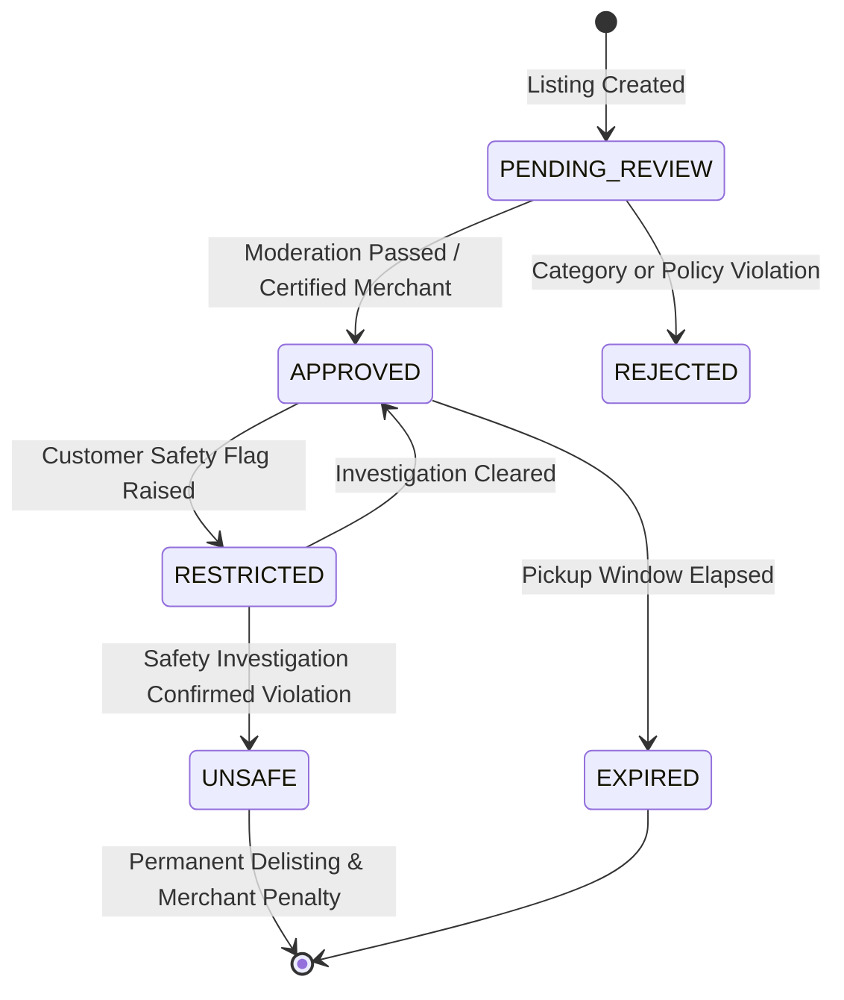

# Food Safety Policy & Engineering Controls — Loqme (لقمه)

> [!CAUTION]
> **LEGAL & PROFESSIONAL DISCLAIMER**:  
> This document represents an internal product, architectural, and engineering policy designed to enforce high hygiene standards.  
> **It does NOT constitute legal, medical, or regulatory health advice.**  
> Final production safety standards, temperature logs, and merchant obligations must be reviewed and certified by qualified Iranian legal counsel and food-safety authorities (وزارت بهداشت، درمان و آموزش پزشکی / سازمان غذا و دارو).  
> Engineers and AI agents must NOT invent or assume Iranian legal statutes.

---

## 1. Safety Directives & Strict Prohibitions

Loqme maintains zero tolerance for compromised food quality. The platform exists solely for fresh, safe, and legally compliant surplus items.

### Explicitly Prohibited Items:
1. **Expired Products (محصولات منقضی‌شده)**:  
   * Any packaged or labeled food product that has passed its printed manufacturer expiration date (تاریخ انقضا) is strictly prohibited.  
   * **Directive**: *Expired does NOT mean discounted.*
2. **Unsafe or Spoiled Food (غذای فاسد یا مشکوک)**:  
   * Any item exhibiting abnormal odor, texture changes, mold, discoloration, souring, or signs of microbial growth.
3. **Previously Served Food (غذای دست‌خورده یا ته‌مانده میز)**:  
   * Food returned from dining tables, open buffet trays, or customer plates is illegal and barred. Only untouched surplus from clean prep kitchens is eligible.
4. **Unknown Handling & Broken Cold Chain (زنجیره سرمای نامشخص)**:  
   * Perishable dairy, prepared poultry, or chilled sandwiches left at ambient room temperature for indeterminate periods.
5. **Unsafe, Damaged or Bloated Packaging (بسته‌بندی معیوب یا بادکرده)**:  
   * Cans with bulges, broken tamper-evident seals, or ripped containers.
6. **Prohibited Product Categories**:  
   * Raw, unpasteurized milk and dairy.  
   * Unpackaged raw minced meat or uninspected raw seafood.  
   * Unregulated home-kitchen prepared meals lacking formal commercial guild health permits.

---

## 2. Listing Safety Status State Machine (`safetyStatus`)

Every listing in the database tracks an explicit `safetyStatus` enum:



### Safety Status Definitions:
* **`PENDING_REVIEW`**: Initial state for listings from newly onboarded or unverified merchants. Ineligible for public search.
* **`APPROVED`**: Cleared for public discovery, reservation, and customer purchase.
* **`RESTRICTED`**: Temporarily frozen from discovery pending admin investigation (e.g. following a customer food hygiene report).
* **`REJECTED`**: Denied by admin moderation due to policy violation (e.g. prohibited category).
* **`UNSAFE`**: Confirmed hazard. Listing is permanently removed, active orders refunded, and merchant flagged for guild review.
* **`EXPIRED`**: The designated `pickupEnd` timestamp has passed. System atomically disables reservation and checkout.

---

## 3. Engineering Controls & Automated Guardrails

1. **Automated Cutoff Lock**: Database queries for active marketplace discovery strictly filter by:
   ```sql
   WHERE "status" = 'PUBLISHED'
     AND "safetyStatus" = 'APPROVED'
     AND "pickupEnd" > NOW();
   ```
2. **Mandatory Allergen & Dietary Metadata**:
   * Merchants cannot publish a Surprise Bag without declaring allergen presence (`GLUTEN`, `DAIRY`, `NUTS`, `EGGS`, `SOY`).
3. **Automated Suspension Trigger**:
   * If a merchant receives two or more food hygiene complaints within a rolling 7-day period, the system automatically transitions all active listings to `RESTRICTED` and alerts the operations safety team.
4. **Packaging Mandate**:
   * All food items handed to customers during pickup must be packed in clean, food-grade, grease-resistant takeaway containers or paper bags.
