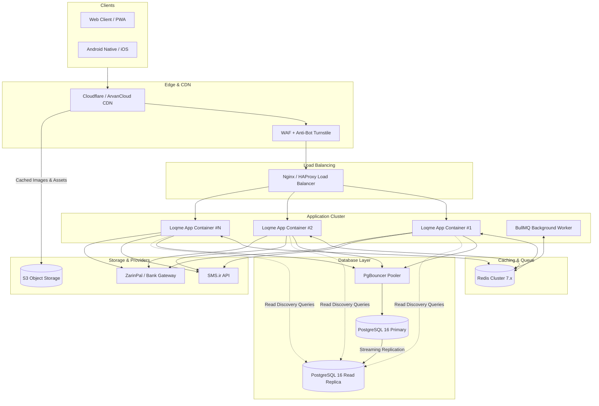

# Loqme (لقمه) — Security Hardening & 1M Users Scalability Guide

> **Target Audience**: Technical Leadership, DevOps Engineers, and Core Developers  
> **Repository Context**: Persian-first Hyper-Local Surplus Marketplace (Next.js 14 App Router, PostgreSQL 16 + PostGIS, Prisma, Redis, Docker)  
> **Benchmark Objective**: Zero-trust security posture and sustained high performance at **1,000,000 registered users** (~100,000 DAU, 2,500+ peak RPS).

---

## 1. Executive Architecture Assessment

Loqme has established strong baseline software engineering practices:
* **PostgreSQL Row-Level Security (RLS)** is enabled across 34 tables with a restricted runtime user ([`createRlsClient`](file:///C:/Users/AliHemmatnia/loqme/apps/web/src/lib/db/rls-client.ts#L11-L62)).
* **Financial Integrity**: Pessimistic locking (`FOR UPDATE`) during payment verification ([`verifyPayment`](file:///C:/Users/AliHemmatnia/loqme/apps/web/src/domain/payment/payment.service.ts#L141-L148)) and advisory locking on inventory reservations.
* **Geospatial Efficiency**: Native PostGIS geometry with GIST indexes on merchant locations ([`idx_merchant_location_geom`](file:///C:/Users/AliHemmatnia/loqme/apps/web/src/domain/merchant/merchant.service.ts#L160-L168)).

However, under 1,000,000 users, the current single-server architecture will experience severe failure points due to **in-memory rate limiting**, **synchronous cleanup inside hot read paths**, **connection pool exhaustion**, and **local disk media storage**.

---

## 2. High-Risk Security Vulnerabilities & Hardening

### 2.1 Distributed Redis Rate Limiting (Preventing SMS Gateway Exhaustion)
* **Vulnerability Identified**:
  - OTP request throttling ([`AuthService.checkRateLimit`](file:///C:/Users/AliHemmatnia/loqme/apps/web/src/domain/auth/auth.service.ts#L36-L57)) and IP guards ([`guardOtpRequest`](file:///C:/Users/AliHemmatnia/loqme/apps/web/src/lib/auth/request-guard.ts#L4-L75)) rely on in-memory JavaScript `Map` structures.
  - Across multiple containers or serverless instances, memory is isolated. Attackers can distribute requests across replicas to bypass throttling, causing massive **SMS toll fraud** and bill inflation on SMS.ir.
  - Iterating over all map entries on every single request (`for (const [key, times] of Array.from(...))`) causes CPU spikes during bursts.
* **Required Fix**:
  - Migrate throttling to Redis using an atomic sliding-window algorithm (via `ioredis` and a Lua script).
  - Rate-limit by both `client_ip` and `normalized_mobile`:
    - **SMS Send**: Max 3 requests per 10 minutes per mobile; max 10 requests per 10 minutes per IP.
    - **OTP Verification**: Max 5 attempts per issued code (already enforced in DB; enforce in Redis to save DB transactions).

```lua
-- Redis Sliding Window Rate Limiter (Lua Script)
local key = KEYS[1]
local now = tonumber(ARGV[1])
local window = tonumber(ARGV[2])
local limit = tonumber(ARGV[3])
local clearBefore = now - window

redis.call('ZREMRANGEBYSCORE', key, 0, clearBefore)
local currentRequests = redis.call('ZCARD', key)

if currentRequests < limit then
    redis.call('ZADD', key, now, now)
    redis.call('EXPIRE', key, math.ceil(window / 1000))
    return 1
else
    return 0
end
```

### 2.2 Session Revocation & Immediate Privilege Invalidation
* **Vulnerability Identified**:
  - Session tokens are stateless signed JWTs valid for 30 days ([`createSessionToken`](file:///C:/Users/AliHemmatnia/loqme/apps/web/src/lib/auth/session.ts#L20-L27)).
  - Terminating staff members or suspending compromised customer accounts does not invalidate existing issued JWT tokens until they expire.
* **Required Fix**:
  - Implement a `tokenVersion` counter on `User`. Include `v: user.tokenVersion` in the JWT payload.
  - Cache revoked sessions or increment `tokenVersion` on user suspension, password change, or logout.
  - Fast-path verification: Check `user:{id}:v` in Redis before granting access to sensitive customer or merchant API endpoints.

### 2.3 Object Storage Migration & CDN Asset Protection
* **Vulnerability Identified**:
  - Uploaded images are stored in local Docker volumes (`/app/.data/listing-images`) and proxied through Next.js dynamic handlers ([`listing-images route`](file:///C:/Users/AliHemmatnia/loqme/apps/web/src/app/api/listing-images/[merchantId]/[filename]/route.ts#L5-L25)).
  - Serving binary data through Node.js consumes memory and blocks the event loop, severely degrading API throughput.
  - Prevents multi-host horizontal container scaling (files uploaded to node 1 do not exist on node 2).
* **Required Fix**:
  - Replace local file storage ([`listingImageStorage`](file:///C:/Users/AliHemmatnia/loqme/apps/web/src/domain/listing/image-storage.ts)) with an S3-compatible service (ArvanCloud Object Storage, MinIO, or Liara).
  - Stream merchant uploads directly from client to S3 using presigned upload URLs.
  - Serve all photos via a CDN with immutable caching (`Cache-Control: public, max-age=31536000, immutable`).

### 2.4 Bot Challenge & Anti-Sniping (Surprise Bag Drops)
* **Threat**: Automated bots grabbing limited surplus items within milliseconds of publication.
* **Required Fix**:
  - Embed **Cloudflare Turnstile** or **ArvanCloud Captcha** on:
    - `POST /api/auth/request-otp`
    - `POST /api/orders/checkout`
  - Restrict active reservations to a maximum of 2 simultaneous pending orders per phone number.

---

## 3. Scalability Blueprint for 1,000,000 Users

### 3.1 Traffic & Resource Projections
* **1M Registered Users** → ~80,000–120,000 Daily Active Users (DAU).
* **Peak Evening Window (19:00 - 22:00)**:
  - Marketplace Discovery: ~1,500 – 3,000 requests/second.
  - Reservation & Checkout: ~200 – 500 transactions/second.
  - Total queries hit: ~12,000 – 25,000 QPS (unsustainable on a single DB without pooling and caching).

---

### 3.2 High-Impact Bottlenecks in the Codebase

#### 1. Eliminate Synchronous Reservation Sweeping in Hot Paths
* **Critical Finding**:
  In [`apps/web/src/app/api/listings/nearby/route.ts`](file:///C:/Users/AliHemmatnia/loqme/apps/web/src/app/api/listings/nearby/route.ts#L78):
  ```typescript
  // LINE 78:
  await reservationService.sweepExpiredReservations();
  ```
  Every single user browsing nearby food listings triggers a database query for expired holds and initiates serial write transactions!
* **Remediation**:
  - Delete `sweepExpiredReservations()` from `nearby/route.ts` and `createReservation()`.
  - Shift expiration to an independent background worker (e.g. BullMQ on Redis or `pg_cron` running every 30 seconds):
  ```sql
  -- Atomic bulk release (executed every 30 seconds by worker)
  WITH expired AS (
    UPDATE "Reservation"
    SET "status" = 'EXPIRED'
    WHERE "status" = 'PENDING' AND "expiresAt" <= NOW()
    RETURNING "listingId", "quantity"
  ),
  aggregated AS (
    SELECT "listingId", SUM("quantity") AS "qty"
    FROM expired
    GROUP BY "listingId"
  )
  UPDATE "ListingInventory" li
  SET "reservedQuantity" = li."reservedQuantity" - agg."qty",
      "version" = li."version" + 1
  FROM aggregated agg
  WHERE li."listingId" = agg."listingId";
  ```

#### 2. PgBouncer Connection Pooling
* **Current Finding**:
  The RLS facade ([`createRlsClient`](file:///C:/Users/AliHemmatnia/loqme/apps/web/src/lib/db/rls-client.ts#L27-L41)) wraps queries in interactive transactions to execute `SET LOCAL ROLE loqme_app`.
  With multiple web instances, PostgreSQL's default `max_connections` (100) will be depleted within seconds.
* **Remediation**:
  - Deploy **PgBouncer** in `transaction` pooling mode.
  - Configure pool parameters:
    ```ini
    [databases]
    loqme = host=postgres port=5432 auth_user=loqme_admin dbname=loqme

    [pgbouncer]
    pool_mode = transaction
    max_client_conn = 5000
    default_pool_size = 50
    reserve_pool_size = 10
    ```

#### 3. Database Indexing & Table Maintenance
* **`OtpCode` Table Bloat**:
  Currently, expired OTP records are never deleted ([`model OtpCode`](file:///C:/Users/AliHemmatnia/loqme/prisma/schema.prisma#L442-L453)). Over months, millions of rows will degrade query performance.
  - Implement a daily purge cron:
    ```sql
    DELETE FROM "OtpCode" WHERE "expiresAt" < NOW() - INTERVAL '48 hours';
    ```
* **Optimize Otp Lookup Index**:
  Add a compound index for OTP verification queries:
  ```prisma
  @@index([mobile, createdAt(sort: Desc)])
  ```
* **Partitioning**:
  Range-partition high-growth audit tables (`PaymentEvent`, `FinancialTransaction`, `AuditLog`) by month.

---

### 3.3 High-Concurrency Architecture Diagram



---

## 4. Phased Implementation Roadmap

### Phase 1: Immediate Stabilizations (0 – 50,000 Users)
- [ ] **Remove Inline Sweep**: Eliminate `sweepExpiredReservations` calls from [`nearby/route.ts`](file:///C:/Users/AliHemmatnia/loqme/apps/web/src/app/api/listings/nearby/route.ts) and [`reservation.service.ts`](file:///C:/Users/AliHemmatnia/loqme/apps/web/src/domain/reservation/reservation.service.ts).
- [ ] **Redis Rate Limiting**: Replace process-local `Map` in `AuthService` and `request-guard.ts` with Redis sliding window.
- [ ] **Daily DB Housekeeping**: Add cron cleanup for `OtpCode` records older than 48 hours.
- [ ] **Direct S3 Offloading**: Configure S3 storage adapter for merchant food images; serve via CDN.

### Phase 2: Horizontal Scaling Readiness (50,000 – 250,000 Users)
- [ ] **PgBouncer Integration**: Put PgBouncer in front of PostgreSQL with transaction pooling.
- [ ] **Redis Geohash Cache**: Cache nearby listings query by geohash (precision 6) with a 30-second TTL.
- [ ] **Token Blacklist**: Fast-path token validity check against Redis on user status changes.
- [ ] **Container Autoscale**: Run 3–6 stateless web application replicas behind Nginx.

### Phase 3: Enterprise 1M User Readiness (250,000 – 1,000,000 Users)
- [ ] **PostgreSQL Read Replicas**: Direct catalog, search, and store discovery queries to read replicas.
- [ ] **Database Partitioning**: Partition `FinancialTransaction`, `OrderHistory`, and `AuditLog` by date range.
- [ ] **Asynchronous Message Queue**: Offload SMS dispatch, webhook delivery, and audit logging to BullMQ background workers.
- [ ] **Bot Challenge Integration**: Active Cloudflare Turnstile / Captcha validation on checkout and OTP request endpoints.
