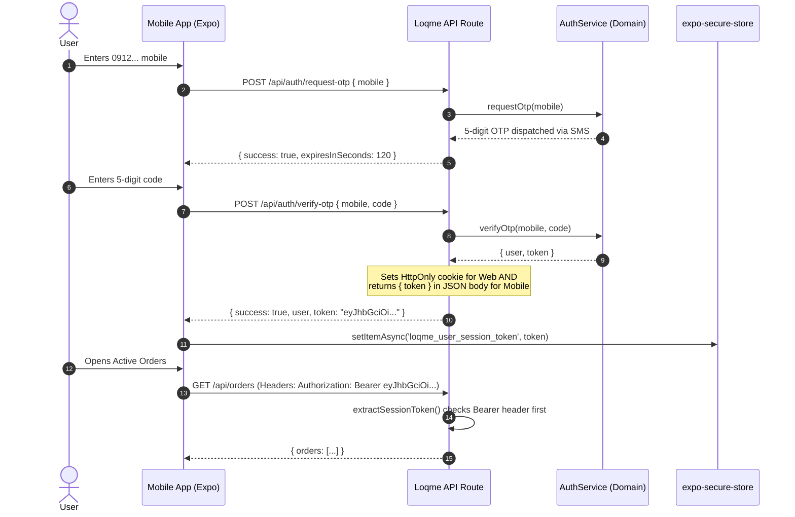

# Mobile Architecture & Multi-Client Strategy — Loqme (لقمه)

> **Architectural Doctrine**: Loqme is a multi-platform product. Web is the inaugural client, but Native Mobile (iOS & Android) is a planned first-class citizen.  
> The server domain services remain the sole authoritative source of truth for business logic, pricing, inventory, security, and transaction state.  
> Web and Mobile are lightweight clients that consume shared contracts without duplicating domain rules.

---

## 1. Why Native Mobile (React Native / Expo)?

Loqme rejects the "WebView-in-a-box" (or PWA wrapper) paradigm for its primary mobile application. Surplus food discovery and pickup handoffs are deeply physical, time-sensitive, and neighborhood-centric interactions:

1. **60-Second Pickup Handoff**: At the merchant counter, customers must instantly present dynamic, animated QR codes or fallback OTPs without web-page reload latency or flaky offline states.
2. **Push Notifications for Surplus Drops**: Surplus inventory ("Surprise Bags") drops within volatile 15–30 minute windows. High-deliverability Apple APNs and Google FCM native push notifications are essential for customer retention.
3. **Hardware-Accelerated Fluidity**: Navigating interactive merchant map clusters, bottom-sheet sliding gestures, and smooth spring physics requires 60/120fps native UI threads.
4. **Camera & Scanner Integration**: Merchant staff scanning customer pickup QR codes require instant native camera stream processing via `expo-camera` without browser permission prompts.
5. **Precise Background Geolocation**: Prompting customers with reminders when entering the pickup geofence (e.g. within 300 meters of the bakery during the 20:00–21:00 window).
6. **Robust Native Biometrics & Storage**: Secure credential and token persistence via `expo-secure-store` and biometric unlock (`expo-local-authentication`).

---

## 2. Multi-Client Architecture & System Topology

```text
                               ┌────────────────────────────────┐
                               │       Authoritative Backend    │
                               │   Next.js Route Handlers /     │
                               │   Domain Services & PostGIS    │
                               └───────────────┬────────────────┘
                                               │
                                 HTTPS REST / JSON Contracts
                                               │
                    ┌──────────────────────────┴──────────────────────────┐
                    ▼                                                     ▼
     ┌─────────────────────────────┐                       ┌─────────────────────────────┐
     │      Web Application        │                       │     Native Mobile App       │
     │      (apps/web)             │                       │     (apps/mobile)           │
     ├─────────────────────────────┤                       ├─────────────────────────────┤
     │ • Next.js App Router        │                       │ • React Native / Expo       │
     │ • Server & Client Comps     │                       │ • Expo Router (Native Tabs) │
     │ • CSS Custom Properties     │                       │ • StyleSheet / NativeWind   │
     │ • Browser Storage / SEO     │                       │ • Native Device APIs        │
     └──────────────┬──────────────┘                       └──────────────┬──────────────┘
                    │                                                     │
                    └──────────────────────────┬──────────────────────────┘
                                               │
                                               ▼
                              ┌─────────────────────────────────┐
                              │         Shared Packages         │
                              │         (packages/*)            │
                              ├─────────────────────────────────┤
                              │ • @loqme/types                  │
                              │ • @loqme/validation             │
                              │ • @loqme/design-tokens          │
                              │ • @loqme/api                    │
                              └─────────────────────────────────┘
```

---

## 3. Shared vs Platform-Specific Concern Matrix

| Concern | Shared Package | Web Client (`apps/web`) | Mobile Client (`apps/mobile`) |
| :--- | :---: | :---: | :---: |
| **Domain Types & Contracts** | `✓` (`@loqme/types`) | Consumes | Consumes |
| **Input Validation (Zod)** | `✓` (`@loqme/validation`) | Consumes | Consumes |
| **Persian Digits & Formats** | `✓` (`@loqme/validation`) | Consumes | Consumes |
| **Design Tokens & Theme** | `✓` (`@loqme/design-tokens`) | CSS Custom Variables | StyleSheet / Native Tokens |
| **API Client & Endpoints** | `✓` (`@loqme/api`) | Consumes (`/api`) | Consumes (`https://api.loqme.shop`) |
| **Authoritative Business Rules** | Backend Only | Disallowed | Disallowed |
| **Pricing & Discount Math** | Backend Only | Disallowed | Disallowed |
| **Inventory State Machine** | Backend Only | Disallowed | Disallowed |
| **UI Components & Layout** | ✗ | React DOM / HTML5 | React Native Primitives (`View`, `Text`) |
| **Navigation & Routing** | ✗ | Next.js App Router | Expo Router / React Navigation |
| **Authentication Transport** | ✗ | HttpOnly Cookies | `Authorization: Bearer <token>` |
| **Token Storage** | ✗ | Browser Cookie Jar | `expo-secure-store` |
| **Camera & QR Scanning** | ✗ | WebRTC / BarcodeDetector | `expo-camera` (Native AVFoundation / CameraX) |
| **Push Notifications** | ✗ | Service Worker Web Push | `expo-notifications` (APNs & FCM) |
| **App Store Submissions** | ✗ | Vercel / Docker / Web Hosting | Apple App Store & Google Play / Cafe Bazaar |

---

## 4. API Client Architecture (`@loqme/api`)

The API client layer abstracts network transport, authentication headers, and Persian error normalization away from client components:

```typescript
import { createApiClient } from '@loqme/api';
import * as SecureStore from 'expo-secure-store';

// Mobile instantiation:
export const mobileApi = createApiClient({
  baseUrl: process.env.EXPO_PUBLIC_API_URL || 'https://api.loqme.shop',
  getAuthToken: async () => {
    return await SecureStore.getItemAsync('loqme_user_session_token');
  },
  onUnauthorized: () => {
    // Dispatch navigation to login sheet
  },
});
```

### Key Capabilities:
- **No Browser Globals**: Operates universally in Node.js, Web (`window.fetch`), and React Native JavaScript runtimes without `window`, `document`, or `localStorage`.
- **Typed Endpoints**: Directly typed against `@loqme/validation` inputs and `@loqme/types` responses.
- **Normalized Errors**: Throws standard `LoqmeApiError` containing HTTP status, internal error code, and user-facing Persian error messages.

---

## 5. Dual-Mode Authentication Architecture

Web and Native Mobile maintain different security paradigms for credential transport:



### Authorization Transport Rules:
1. **Web**: Next.js automatically receives and passes the `loqme_session` HttpOnly cookie.
2. **Mobile**: Stores signed JWT in `expo-secure-store`; passes it as `Authorization: Bearer <token>` in the HTTP request headers.
3. **Middleware & Handlers**: `extractSessionToken(request)` authoritatively checks:
   - First: `Authorization: Bearer <token>`
   - Fallback: `request.cookies.get('loqme_session')`
4. **Logout**:
   - Web: Clears the `loqme_session` cookie.
   - Mobile: Purges the token key from `expo-secure-store`.

---

## 6. Design Tokens & Visual Parity

Both Web and Mobile render the exact same **White + Teal / Dark Turquoise (سبز کله‌غازی)** visual identity from `@loqme/design-tokens`:

### Palette Reference:
* **Primary Brand**: `#0F766E` (`primary[600]`) — Primary CTAs, active tab icons, key highlight borders.
* **Canvas Foundation**: `#FFFFFF` (`neutral[0]`) — 70–85% clean white background.
* **Slate Typography**: `#0F172A` (`neutral[900]`) — High-contrast Iranian headlines and descriptions.
* **Soft Teal Surface**: `#F0FDFA` (`primary[50]`) — Selected cards, bag discount tags.
* **Verified Emerald**: `#10B981` (`success[500]`) — Food safety certifications and verified store badges.

### Emil Kowalski Craft Motion on Mobile:
* **Active Press Scaling**: Buttons and cards scale to `0.97` on touch start (`activeOpacity={0.9}` / `useAnimatedStyle`).
* **Physics Curves**: Sheets and modals follow `drawer` bezier (`cubic-bezier(0.32, 0.72, 0, 1)`) or spring configurations (`damping: 24, stiffness: 260`).

---

## 7. Typography & Persian Localization in React Native

* **Font Family**: **Vazirmatn** (Open Font License, OFL 1.1).
* **Licensing**: Free for commercial distribution without licensing fees.
* **Mobile Asset Loading**:
  ```typescript
  import { useFonts } from 'expo-font';

  export function useLoqmeFonts() {
    return useFonts({
      'Vazirmatn-Regular': require('@/assets/fonts/Vazirmatn-Regular.ttf'),
      'Vazirmatn-Medium': require('@/assets/fonts/Vazirmatn-Medium.ttf'),
      'Vazirmatn-SemiBold': require('@/assets/fonts/Vazirmatn-SemiBold.ttf'),
      'Vazirmatn-Bold': require('@/assets/fonts/Vazirmatn-Bold.ttf'),
    });
  }
  ```
* **RTL Layout**: Enforced via `I18nManager.allowRTL(true)` and `I18nManager.forceRTL(true)`.

---

## 8. Geolocation Architecture (Authoritative PostGIS)

Loqme discovery is strictly hyper-local (within 1km to 5km). Geographic calculations are **server-authoritative**:

1. Mobile client requests device location via `expo-location` (`Location.getCurrentPositionAsync({ accuracy: Location.Accuracy.Balanced })`).
2. Client queries the API: `GET /api/listings/nearby?lat=35.7219&lng=51.3347&radius=3000`.
3. PostGIS runs spatial indexing on PostgreSQL:
   ```sql
   SELECT id, title, price, ST_Distance(store_geom, ST_MakePoint(51.3347, 35.7219)::geography) AS distance_meters
   FROM listings
   WHERE ST_DWithin(store_geom, ST_MakePoint(51.3347, 35.7219)::geography, 3000)
     AND status = 'ACTIVE'
   ORDER BY distance_meters ASC;
   ```
4. Mobile receives pre-calculated, sorted distance values formatted in Persian (`۱.۴ کیلومتر`). The client **never** performs raw distance math or client-side filtering of full database listings.

---

## 9. Payments & Mobile Handoff

Iranian online payment gateways (Saman, Zarinpal, Shaparak) require redirecting the cardholder to the bank's Web IPG:

1. **Initiation**: Mobile calls `POST /api/orders/:id/pay`. Backend creates an atomic payment record and returns an authoritative gateway payment URL and transaction token.
2. **In-App Browser**: Mobile opens the gateway URL using `expo-web-browser` or `expo-in-app-purchases`:
   ```typescript
   import * as WebBrowser from 'expo-web-browser';
   const result = await WebBrowser.openAuthSessionAsync(paymentUrl, 'loqme://payment-callback');
   ```
3. **Gateway Verification**: The payment gateway calls the backend callback route directly. The backend verifies the cryptographic signature with Shaparak, transitions the order to `PAID`, and issues a deep link redirect back into the mobile app (`loqme://orders/:id?status=success`).
4. **Security Boundary**: The mobile app **never** marks an order paid on its own. It refreshes order state from the authoritative backend upon receiving the deep link.

---

## 10. Future Repository Structure (`apps/mobile`)

When mobile development begins in `M-Mobile-01`, the repository structure will expand smoothly without altering existing packages:

```text
loqme/
├── apps/
│   ├── web/                     # Next.js 14 Web Application
│   └── mobile/                  # [Future M-Mobile-01]
│       ├── app/                 # Expo Router file-based routes
│       │   ├── (tabs)/          # Customer tabs: Explore, Saved, Orders, Profile
│       │   ├── bag/[id].tsx     # Surprise Bag details & reservation
│       │   ├── pickup/[id].tsx  # Dynamic QR pickup screen
│       │   └── _layout.tsx      # Root RTL Provider & Auth Guard
│       ├── assets/fonts/        # Vazirmatn font binaries
│       ├── components/          # Native UI components (NativeWind / StyleSheet)
│       ├── app.json             # Expo project configuration & Bundle ID
│       ├── package.json         # Depends on @loqme/api, @loqme/types, etc.
│       └── tsconfig.json
│
├── packages/
│   ├── api/
│   ├── types/
│   ├── validation/
│   ├── design-tokens/
│   └── config/
└── prisma/
```

---

## 11. Recommended Mobile Milestone Progression

Mobile development is scheduled as a dedicated milestone track following core domain stabilization:

1. **M-Mobile-01 — Mobile Architecture & Foundation**: Expo Router setup, Vazirmatn font loading, SecureStore auth token flow, RTL shell layout.
2. **M-Mobile-02 — Customer Discovery & Maps**: MapView cluster, nearby Surprise Bag cards, category filtering via `@loqme/api`.
3. **M-Mobile-03 — Authentication & Profile**: Native phone OTP input with auto-read (SMS Retriever API), profile management.
4. **M-Mobile-04 — Orders & Reservation Countdown**: 10-minute reservation lock screen, WebBrowser IPG checkout, order history.
5. **M-Mobile-05 — Pickup Verification (QR & Geofence)**: High-brightness dynamic QR code generator, countdown timer, pickup reminders.
6. **M-Mobile-06 — Push Notifications & Native Polish**: APNs / FCM background message handlers, haptic feedback (`expo-haptics`), pull-to-refresh.
7. **M-Mobile-07 — Merchant Mobile Companion**: Barcode camera scanner for merchant staff, quick surplus drop creator.
8. **M-Mobile-08 — App Store & Production Release**: EAS Build configuration, Apple App Store & Google Play / Cafe Bazaar release pipelines.

---

## 12. Pre-Mobile Checklist & Known Blockers

Before launching `M-Mobile-01`, the following items must be in place:

- [x] Shared types extracted into `@loqme/types`.
- [x] Shared validation extracted into `@loqme/validation`.
- [x] Shared design tokens extracted into `@loqme/design-tokens`.
- [x] Universal API client created in `@loqme/api`.
- [x] Backend auth routes and middleware support `Authorization: Bearer <token>`.
- [x] `POST /api/auth/verify-otp` returns session token in response body.
- [ ] Core database domain models (Merchants, Listings, Inventory) implemented in M02.
- [ ] PostGIS spatial query endpoints implemented in M03.
- [ ] Payment gateway adapter and deep link scheme (`loqme://`) registered in M04.
