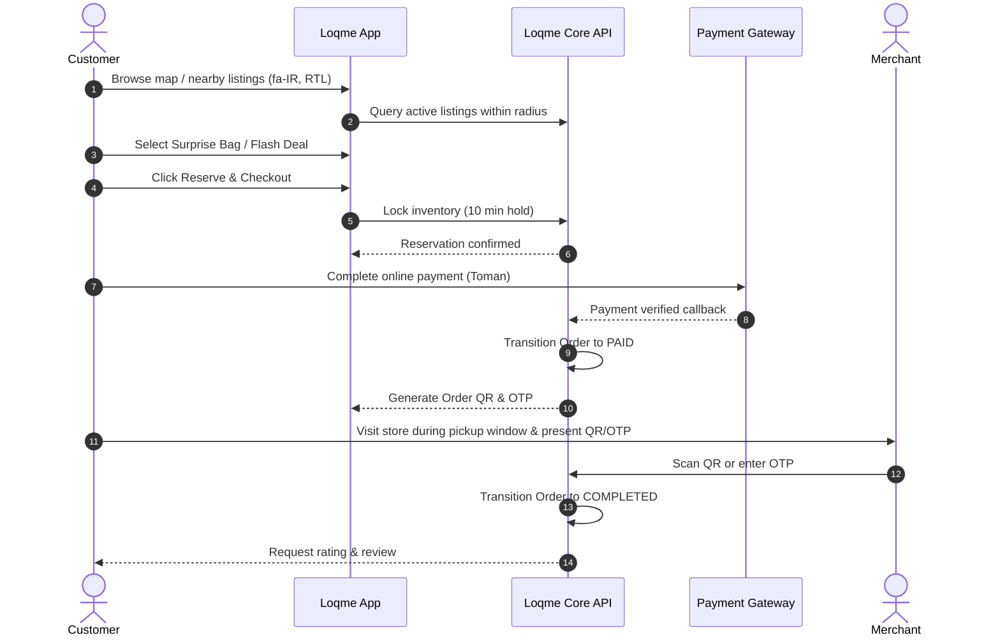

# Product Specification — Loqme (لقمه)

> **Official Brand**: Loqme (لقمه)  
> **Domain**: [loqme.shop](https://loqme.shop)  
> **Status**: Approved Product Specification

---

## 1. Problem Statement

In urban Iran, food businesses (bakeries, confectioneries, cafes, supermarkets, restaurants, and produce markets) face daily inventory volatility due to shifting customer footfall, weather, and fresh-preparation cycles. At the close of business, significant volumes of completely safe, freshly prepared, high-quality food remain unsold.

Simultaneously:
1. **Consumer Purchasing Power Pressure**: Economic inflation has tightened household budgets. Consumers actively seek ways to enjoy quality meals and artisanal treats without overspending.
2. **Retail Margin Erosion**: Unsold surplus represents total financial loss and inventory write-offs for neighborhood merchants.
3. **Logistical Disconnect**: Until now, no dedicated, respectable digital marketplace connected local shops with neighborhood residents seeking value and discovery at day's end.

---

## 2. Product Definition & Vision

**Loqme** is a Persian-first, hyper-local marketplace that allows approved local food and grocery businesses to offer safe, legally sellable, surplus or time-sensitive inventory directly to nearby consumers at significant discounts (typically 40% to 70% off standard retail prices).

### What Loqme IS:
* A curated, high-trust discovery channel for fresh food value.
* A hyper-local pickup marketplace empowering neighborhood community commerce.
* A platform celebrating smart shopping and culinary serendipity.

### What Loqme IS NOT:
* **NOT an expired goods marketplace**: Products past expiration date are strictly illegal and prohibited.
* **NOT a garbage or plate-leftover marketplace**: Zero tolerance for previously served or substandard food.
* **NOT a conventional food delivery app clone**: MVP relies on in-person pickup, eliminating exorbitant delivery fleet markups.
* **NOT a generic coupon aggregator**: Every listing represents real, physical inventory reserved in real time.
* **NOT a charity or guilt-driven NGO**: We are a sustainable commercial marketplace founded on economic value and customer delight.

---

## 3. Target Audiences & Personas

### 3.1 Consumers
* **Smart Budget Optimizers**: University students, young professionals, and cost-conscious families seeking quality nourishment while managing monthly budgets.
* **Food Enthusiasts & Artisanal Explorers**: Cafe and pastry lovers eager to sample high-end patisseries and specialty roasters at affordable rates.
* **Convenient Neighborhood Residents**: Walk-in locals living or working within walking distance (500m–2km) of partner stores.

### 3.2 Merchants
* **Artisanal Bakeries & Pastry Shops (نانوایی و قنادی)**: Daily bake cycles resulting in surplus evening pastries, artisanal breads, and cakes.
* **Specialty Cafes & Coffee Shops (کافه‌ها)**: Unsold sandwiches, salads, cold brews, and baked treats prepared fresh daily.
* **Restaurants & Delis (رستوران‌ها و کترینگ‌ها)**: High-quality surplus portions from lunch and dinner batches.
* **Local Supermarkets & Grocers (سوپرمارکت‌ها)**: Packaged goods nearing "best before" dates (dairy, juices, specialty snacks) with complete safety clearance.
* **Produce & Fruit Markets (میوه‌فروشی‌ها)**: Ripe seasonal fruits and vegetables ready for immediate consumption or cooking.

---

## 4. Value Propositions

| Stakeholder | Core Value Proposition |
| :--- | :--- |
| **Consumer** | • 40%–70% savings on delicious, premium local food. • Thrill of discovering new neighborhood culinary gems. • Frictionless in-app reservation and rapid in-store pickup. • Absolute assurance of hygiene and product safety. |
| **Merchant** | • Immediate revenue recovery from sunk food preparation costs. • Zero-cost customer acquisition: draws new foot traffic through physical doors. • Effortless inventory listing tools (under 60 seconds to list). • Enhanced local community goodwill without brand dilution. |
| **Society** | • Concrete reduction of urban food waste. • Support for local neighborhood retail sustainability. • Dignified, smart consumption behavior. |

---

## 5. Marketplace Dynamics & Listing Types

Loqme operates a two-sided hyper-local marketplace centered on two distinct listing formats:

### 5.1 Surprise Bag (بسته شگفت‌انگیز)
* **Concept**: The merchant specifies a category (e.g. "بسته شیرینی و کیک عصرانه"), a fixed low purchase price (e.g. ۶۰,۰۰۰ تومان), and a **guaranteed minimum retail value** (e.g. ۱۵۰,۰۰۰ تومان).
* **Execution**: Exact contents depend on what remains fresh at the end of the shift. The customer buys with the anticipation of delight and high value.
* **Safety Floor**: Strict item categorization and dietary/allergen labeling upfront.

### 5.2 Flash Deal (پیشنهاد ویژه)
* **Concept**: Specific, identified surplus inventory items (e.g. "سالاد سزار آماده مصرف" or "ساندویچ مرغ و ریحان") with known quantities and explicit original vs discounted pricing.
* **Execution**: Best suited for items where customers demand certainty regarding exact ingredients or portion size.

---

## 6. End-to-End User Flows

### 6.1 Customer Flow

### 6.2 Merchant Flow
1. **Registration & Verification**: Merchant registers, provides guild license (جواز کسب), tax ID, and store location coordinates.
2. **Setup Pickup Windows**: Configure daily operating hours and default surplus pickup windows (e.g. 20:30–22:00).
3. **Publish Daily Surplus**: Merchant assesses unsold inventory 1–2 hours before closing, sets quantity of Surprise Bags or Flash Deals, and publishes in one tap.
4. **Order Notification & Packing**: Merchant receives incoming order alerts, prepares and bags the items.
5. **Customer Verification**: When customer arrives, merchant scans the dynamic QR code in the Loqme merchant portal (or enters the 4-digit OTP).
6. **Payout Settlement**: Bi-weekly automated bank transfer (پایا / ساتنا) of gross earnings minus agreed platform commission.

### 6.3 Admin Flow
1. **Merchant Verification**: Inspect submitted guild permits, health certificates, and store images before approving active status.
2. **Category & Safety Moderation**: Supervise listing descriptions, enforce prohibited food policies, and monitor safety alerts.
3. **Dispute & Refund Resolution**: Handle customer complaints (e.g. store closed during pickup window, substandard bag value) and trigger automated financial refunds.
4. **Commission & Financial Oversight**: Adjust global or merchant-specific commission rates and export settlement sheets.
5. **Ecosystem Health Metrics**: Monitor neighborhood supply density, pickup completion rates, and customer NPS.

---

## 7. MVP Scope vs Future Roadmap

### 7.1 In Scope for MVP
* Customer mobile web / PWA application (Persian-first, responsive, RTL).
* Hyper-local listing discovery with interactive map and list views (PostGIS geo-queries).
* Surprise Bag and Flash Deal inventory management.
* Atomic reservation lock mechanism (10-minute hold).
* Iranian payment gateway integration (Saman/Zarinpal abstraction) with automated callback verification.
* In-person pickup verification via secure dynamic QR code and 4-digit OTP.
* Merchant management portal (listing creation, order scanning, operating hours).
* Admin console (merchant verification, dispute moderation, commission settings).
* Customer review and rating loop.

### 7.3 Geographic Launch Strategy
* **Phase 1 Launch (Pilot City — ارومیه / Urmia)**:
  * Initial commercial pilot launch in **Urmia** (West Azerbaijan Province).
  * High-density corridors: خیابان دانشکده (Daneshkadeh), استادان (Ostadan), شیخ‌تپه (Sheykh Tappeh), خیام (Khayyam), کاشانی (Kashani), امام (Emam), بهداری و درستکار.
  * Core focus: Local artisanal confectioneries (نقل و حلوای سنتی), bakeries, cafes, produce markets, and neighborhood supermarkets to build supply density and customer habit loops.
* **Phase 2 Expansion (Tehran & Metropolises — تهران و کلان‌شهرها)**:
  * Expanding proven operational playbooks and network density to Tehran (سعادت‌آباد، شهرک غرب، تجریش، انقلاب، صادقیه) and other major metropolises.

---

## 8. Non-Goals

1. **Not a General Food Delivery Service**: Loqme does not maintain a dedicated motor courier fleet or compete with SnappFood/Delino on instant dinner delivery.
2. **Not a Clearance Bin for Expired Goods**: We will never allow goods past their manufacturer expiration date.
3. **Not a Waste Management Platform**: We do not process plate scraps, compost, or inedible organic byproducts.
4. **Not an Unregulated Home-Kitchen Marketplace**: Unlicensed residential kitchens without formal commercial health permits are strictly ineligible for onboarding.
