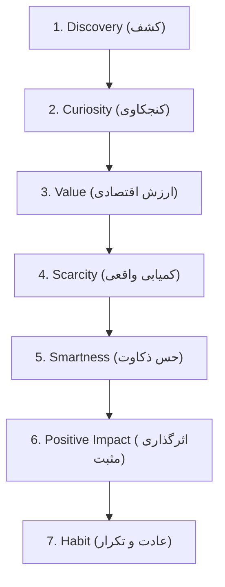

# UX Psychology & Behavioral Architecture — Loqme (لقمه)

> **Core Philosophy**: Empowering the "Smart Shopper" through dignity, excitement, and verifiable value.

---

## 1. The Customer Psychological Journey

1. **Discovery (کشف)**: The user opens the app and sees nearby local spots offering fresh surprise packages and flash items. Visuals are warm, inviting, and appetizing.
2. **Curiosity (کنجکاوی)**: "What will tonight's bakery bag contain? Maybe sourdough, almond croissants, or fruit tarts?"
3. **Value (ارزش ملموس)**: Clear comparison of standard retail worth (e.g. ۱۸۰,۰۰۰ تومان) vs. the Loqme purchase price (۶۵,۰۰۰ تومان).
4. **Scarcity (کمیابی اصیل)**: Awareness that daily surplus is finite ("فقط ۲ بسته باقی مانده") creates genuine, healthy decision momentum.
5. **Smartness (حس افتخار و ذکاوت)**: The customer feels proud of their clever purchase: *"I secured a premium treat for a fraction of the cost."*
6. **Positive Impact (تاثیر مثبت)**: Upon pickup, a brief celebratory acknowledgment reinforces good stewardship of quality food.
7. **Habit (عادت روزانه)**: Consistent afternoon/evening drop times create an intuitive daily ritual.

---

## 2. Behavioral Dynamics & Cognitive Framing

### 2.1 Price Framing & Anchoring
* **Reference Anchoring**: Always display the honest original retail value as a crossed-out reference (e.g. `~~۱۸۰,۰۰۰ تومان~~`), paired directly with the bold Loqme price (`۶۵,۰۰۰ تومان`).
* **Percentage Badge**: Highlight the discount ratio prominently (`۶۴٪ تخفیف`) using the warm orange brand badge.
* **Avoid Deceptive Baselines**: The reference price must be strictly verified against store shelf prices.

### 2.2 Savings Display (صرفه‌جویی تجمعی)
* In the customer profile, track cumulative lifetime savings:  
  **"تا امروز ۳۴۰,۰۰۰ تومان هوشمندانه صرفه‌جویی کرده‌اید"**
* Celebrate milestones (e.g. 5th bag collected, ۱ میلیون تومان saved) to reinforce the smart shopper persona.

### 2.3 Scarcity & Urgency (Authentic vs. Fake)
* **Real Scarcity Only**: Inventory counts must reflect actual available database records.
* **Pickup Window Countdown**: Clearly present the remaining pickup time (e.g. `زمان تحویل: امروز ۲۰:۳۰ تا ۲۱:۴۵ — ۴۵ دقیقه مانده`).
* **No Dark Patterns**: Never reset countdown clocks, never fabricate "X people looking at this now", and never display artificial out-of-stock messages.

### 2.4 Surprise Bag Psychology (روانشناسی بسته شگفت‌انگیز)
* **Anticipation & Mystery**: Borrowing from positive gamification and mystery boxes, customers enjoy unboxing unexpected delights.
* **Minimizing Disappointment Risk**:
  * Set a strict minimum guaranteed retail value.
  * Require explicit category definitions (e.g. "نان و باگت" vs. "کیک و شیرینی تر").
  * Require dietary flags (وجترین، حاوی بادام زمینی، حاوی گلوتن).

### 2.5 Trust & Social Proof
* **Verified Reviews Only**: Ratings and reviews can only be submitted by customers who completed an authenticated in-person pickup.
* **Neighborhood Proof**: Highlight store reliability:  
  `امتیاز ۴.۸ از ۵ (۸۵ خرید موفق در محله شما)`
* **100% Quality Guarantee**: Explicit promise of hassle-free refund if items are spoiled, expired, or fall below the guaranteed value floor.

### 2.6 Customer Identity (Dignity over Charity)
* Customers must never feel stigmatized. The tone of the application is modern, aspirational, and savvy.
* Language uses positive terms like **«کشف روز»** (Daily Discovery), **«شکار لحظه‌ها»** (Smart Catch), and **«بسته شگفت‌انگیز لقمه»** (Loqme Surprise Bag).
* Never describe food as "ضایعات" (waste), "پسماند" (scrap), or "ته‌مانده" (leftovers).

### 2.7 Retention & Habit Formation
* **Scheduled Drop Windows (زمان انتشار بسته‌ها)**: Partner stores upload surplus during predictable daily windows (e.g. bakeries at 16:00 and 20:00).
* **Store Favorites**: Customers can "star" favorite neighborhood cafes and receive an instant notification when a bag is released.

### 2.8 Notification Psychology
* Notifications must be high-utility, timely, and respectful:
  * *Prompt*: «نانوایی روحی ۲ بسته عصرانه جدید ثبت کرد. تحویل تا ساعت ۲۱:۳۰»
  * *Reminder*: «یادآوری: ۱ ساعت تا پایان زمان دریافت لقمه شما از کافه گراف باقی مانده است.»
* Never send spam, manipulative clickbait, or late-night non-actionable alerts.

---

## 3. Explicitly Prohibited UX Antipatterns

| Antipattern | Why It is Strictly Banned |
| :--- | :--- |
| **Guilt-First UX** | Guilt-tripping users about environmental catastrophe or starvation creates negative emotional residue and ruins brand affinity. |
| **Shame / Leftovers Stigma** | Treating discounted items as low-class charity alienates mainstream consumers and devalues partner brands. |
| **Fake Urgency** | Fake countdown timers that restart on page refresh destroy customer trust. |
| **Fake Scarcity** | Fabricated "Only 1 left!" badges or deceptive live-visitor counters are unethical dark patterns. |
| **Manipulative Checkout** | Hidden service charges, surprise fees, or pre-selected optional donations violate our transparency principle. |
| **Hidden Product Information** | Concealing allergen data or packaging expectations just to increase conversion is unacceptable. |
