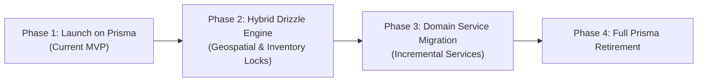

# ADR-002: ORM Strategy & High-Scale Database Layer (Prisma vs Drizzle)

* **Status**: `Proposed / Phased Adoption Strategy`
* **Date**: 2026-10-23
* **Deciders**: Loqme Architecture Team
* **Consulted**: AGENTS.md Governance, Marketplace Concurrency & Security Rules

---

## 1. Context & Problem Statement

Loqme is an ultra-fast, hyper-local marketplace operating under specific relational and transactional constraints:
1. **PostGIS Proximity**: Continuous real-time geospatial radius searches (`ST_DWithin`, `ST_Distance`) calculating store proximity within 3–5 km.
2. **Pessimistic Concurrency**: 10–15 minute inventory locks during checkout to prevent overselling surplus food packs.
3. **Double-Entry Financial Transactions**: Merchant wallets, Paya bank payouts, platform commission cuts, and instant refunds.
4. **PostgreSQL Row-Level Security (RLS)**: Enforced across 36 tables to isolate merchant and customer private records.

The project currently uses **Prisma ORM 7.x**. As Loqme prepares for regional launch and expansion to thousands of concurrent requests during peak evening surplus hours (8:00 PM – 10:30 PM), a strategic evaluation between **Prisma ORM** and **Drizzle ORM** was requested.

---

## 2. Decision Summary

We adopt a **Pragmatic Phased Strategy**:
1. **Short-Term (MVP & Launch)**: **Retain Prisma ORM**. The current codebase has over 1,000 automated tests, 17 applied migrations, and stable RLS runtime bindings. An immediate full rewrite poses unacceptable risk to launch deadlines.
2. **Long-Term Target (Scale)**: **Drizzle ORM** is recognized as the superior architectural fit for Loqme at high scale due to native PostGIS composability, first-class `SELECT ... FOR UPDATE` row locking, zero-engine query execution, and a 90% smaller memory footprint.
3. **Mid-Term Bridge**: Allow Drizzle to be introduced incrementally for specialized high-throughput engines (Geospatial Discovery & Inventory Locking) connecting to the same shared PostgreSQL pool.

---

## 3. Detailed Comparison

| Feature / Metric | Prisma ORM | Drizzle ORM | Architectural Impact on Loqme |
| :--- | :--- | :--- | :--- |
| **PostGIS Integration** | `Unsupported("geometry")` + forced `$queryRaw` | First-class `customType` + composable SQL expressions | High: Discovery is our #1 user entry point. |
| **Financial Row Locking** | No `.forUpdate()` in CRUD (must use raw SQL) | Native `.for('update')` and `.skipLocked()` | High: Prevents duplicate order reservation race conditions. |
| **Execution Latency** | Query engine translation + object overhead (~5–15ms) | Parameterized SQL compilation (<0.5ms) | High: Crucial during flash deal spikes. |
| **Cold Starts & Memory** | Heavy (~30–50MB memory, engine binary) | Featherlight (<50KB, pure JS/TS) | Medium: Optimizes serverless/edge route scaling. |
| **Migration Stability** | Mature shadow-db migrations (`prisma migrate`) | SQL file generator (`drizzle-kit`) | Low: Both generate reliable SQL. |
| **Type Synchronization** | Generated from `.prisma` DSL (build step required) | Inferred directly from TypeScript schema | Medium: Eliminates monorepo schema desync. |

---

## 4. Phased Implementation Roadmap

1. **Phase 1 (Active)**: Maintain Prisma 7 with existing driver adapter (`@prisma/adapter-pg`) and RLS client extensions.
2. **Phase 2 (Post-Launch Optimization)**: Introduce `drizzle-orm` in `apps/web/src/domain/discovery` for geospatial radius indexing and in `ReservationService` for row-level concurrency locks.
3. **Phase 3 (Service Migration)**: Introspect existing schema with `drizzle-kit introspect` and migrate remaining domain services (`OrderService`, `PaymentService`, `MerchantBankService`).
4. **Phase 4 (Unified Stack)**: Remove `@prisma/client`, reducing Docker container footprints and build durations.
