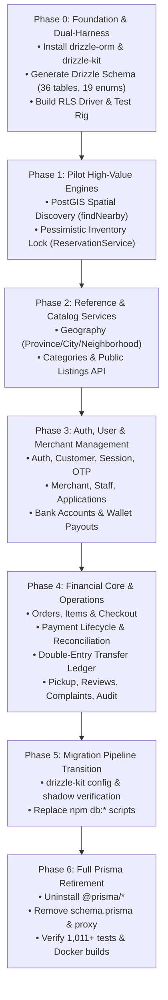

# Loqme — ORM Migration Plan: Prisma to Drizzle

> **Plan ID: LQ-ORM-001**  
> **Status: Ready for Implementation / Phased Execution**  
> **Reference Decision**: [ADR-002: ORM Strategy & High-Scale Database Layer (Prisma vs Drizzle)](../decisions/ADR-002-orm-strategy-prisma-vs-drizzle.md)  
> **Governance Authority**: [AGENTS.md](../../AGENTS.md) · [DATABASE_RLS.md](../DATABASE_RLS.md) · [PROJECT_STATUS.md](../PROJECT_STATUS.md)  
> **Target Database**: PostgreSQL 15/16 + PostGIS extension  

---

## 1. Executive Summary

This plan specifies the technical strategy, schema mapping, security controls, and step-by-step phased execution for replacing **Prisma ORM 7.x** with **Drizzle ORM** across the Loqme monorepo.

### 1.1 The Problem with Prisma in Loqme
Loqme is an ultra-fast hyper-local surplus food marketplace operating under strict operational bounds:
1. **PostGIS Spatial Queries**: Continuous proximity discovery (`ST_DWithin`, `ST_Distance`) calculating store proximity within 3–5 km. Prisma treats geography columns as `Unsupported("geography(Point, 4326)")`, forcing string concatenation and `$queryRaw` across discovery routes.
2. **Pessimistic Concurrency**: 10–15 minute inventory locks during checkout to prevent overselling surplus food packs. Prisma CRUD lacks native row locking (`FOR UPDATE`), requiring awkward raw SQL bypasses.
3. **PostgreSQL Row-Level Security (RLS)**: Enforced across 36 tables with the `loqme_runtime` non-owner login and `loqme_app` transaction-local context. Prisma requires an invasive proxy facade (`apps/web/src/lib/db/rls-client.ts`) that wraps every single model call in an interactive transaction with runtime introspection.
4. **Binary & Memory Overhead**: Prisma's query engine binary adds 30–50MB memory footprint per process, cold-start latency, and extra Docker build overhead.

### 1.2 Target State with Drizzle
- **Pure TypeScript & Zero Binary**: Featherlight (<50KB), zero query engine overhead, sub-millisecond SQL compilation.
- **Native PostGIS Composable SQL**: Type-safe spatial expressions and indexing directly integrated into the query builder.
- **First-Class Row-Level Locking**: Native `.for('update')` and `.for('update', { skipLocked: true })` for inventory reservations and financial balance updates.
- **Clean RLS Driver Hooks**: Transaction-local session parameter setting (`loqme.user_id`, `loqme.service`, etc.) natively bound to `pg.Pool` connection checkouts and transactions without proxy overhead.
- **Shared Connection Pool**: Both Prisma and Drizzle can coexist during the phased migration against the exact same PostgreSQL database.

---

## 2. Technical Inventory & Architecture Baseline

### 2.1 Database Entities (36 Tables & 19 Enums)
The existing PostgreSQL schema contains 36 tables (all with `ENABLE/FORCE ROW LEVEL SECURITY`) and 19 PostgreSQL `ENUM` types:

| Domain Area | Tables (Models) | Enums |
| :--- | :--- | :--- |
| **Identity & Access** | `User`, `Customer`, `Session`, `OtpCode`, `Favorite` | `Role` |
| **Merchant & Staff** | `Merchant`, `MerchantStaff`, `MerchantApplication`, `MerchantHours`, `MerchantLocation`, `MerchantBankAccount`, `MerchantPayoutRequest` | `BusinessType`, `VerificationStatus`, `MerchantApplicationStatus`, `StaffRole`, `BankAccountStatus`, `PayoutRequestStatus` |
| **Reference Geography** | `Province`, `City`, `Neighborhood` | — |
| **Catalog & Listings** | `Category`, `Listing`, `ListingImage`, `ListingInventory`, `ListingSafety`, `ListingAttributes`, `ListingRevision`, `ListingInventoryMovement` | `ListingType`, `ListingStatus`, `SafetyStatus`, `TemperatureRequirement` |
| **Orders & Concurrency** | `Reservation`, `Order`, `OrderItem` | `ReservationStatus`, `OrderStatus` |
| **Payment & Ledger** | `Payment`, `PaymentEvent`, `FinancialTransaction`, `Refund`, `PaymentAttempt`, `ReconciliationCase` | `PaymentGatewayType`, `PaymentStatus`, `FinancialTransactionType`, `RefundStatus` |
| **Operations & Trust** | `PickupVerification`, `Review`, `Complaint`, `AuditLog` | `ComplaintCategory`, `ComplaintStatus` |

### 2.2 Critical Invariants That Must NOT Regress
1. **PostgreSQL RLS Invariant**: All application access MUST connect via `loqme_runtime` and run under transaction-local `loqme_app` with `set_config('loqme.*', ..., true)`.
2. **Financial Precision Invariant**: All currency amounts are integer Tomans (`Int` in Prisma, `integer` in PostgreSQL); no floating point math.
3. **Double-Entry Ledger Integrity**: Every payout, refund, and payment completion MUST write immutable ledger records atomically.
4. **Pessimistic Inventory Locking**: Concurrent checkout reservations must never oversell surplus stock.
5. **Test Suite Parity**: All 1,011 automated unit, integration, and RLS tests must pass throughout every migration phase.

---

## 3. Core Technical Designs for Drizzle

### 3.1 Drizzle Schema Architecture (`packages/db` or `apps/web/src/db`)

Create a centralized database module. In alignment with multi-client architecture ([AGENTS.md](../../AGENTS.md) Section 7), database schema definitions are placed in `packages/db` or `apps/web/src/db` with modular domain exports:

```
apps/web/src/db/
├── index.ts                  # Drizzle client singleton & connection pool
├── rls.ts                    # RLS transaction helper & context injector
├── schema/
│   ├── enums.ts              # 19 PostgreSQL pgEnum definitions
│   ├── spatial.ts            # Custom PostGIS geography(Point, 4326) type
│   ├── auth.ts               # User, Customer, Session, OtpCode, Favorite
│   ├── merchant.ts           # Merchant, Staff, Hours, Location, BankAccount, Payout
│   ├── geography.ts          # Province, City, Neighborhood
│   ├── catalog.ts            # Category, Listing, Image, Inventory, Safety, Attributes
│   ├── orders.ts             # Reservation, Order, OrderItem
│   ├── finance.ts            # Payment, Event, Attempt, FinancialTransaction, Refund, Reconciliation
│   ├── operations.ts         # PickupVerification, Review, Complaint, AuditLog
│   └── relations.ts          # Type-safe relations() for Drizzle relational queries
```

### 3.2 PostGIS Geography Type in Drizzle (`apps/web/src/db/schema/spatial.ts`)

```typescript
import { customType } from 'drizzle-orm/pg-core';

export interface PointGeometry {
  type: 'Point';
  coordinates: [number, number]; // [lng, lat]
}

export const postgisPoint = customType<{
  data: PointGeometry;
  driverData: string;
}>({
  dataType() {
    return 'geography(Point, 4326)';
  },
  toDriver(value: PointGeometry): string {
    return `SRID=4326;POINT(${value.coordinates[0]} ${value.coordinates[1]})`;
  },
  fromDriver(value: string): PointGeometry {
    // Parses PostGIS hex EWKB or WKT representation
    const match = value.match(/POINT\(([^ ]+) ([^ ]+)\)/i);
    if (!match) return { type: 'Point', coordinates: [0, 0] };
    return {
      type: 'Point',
      coordinates: [parseFloat(match[1]), parseFloat(match[2])],
    };
  },
});
```

### 3.3 PostGIS Composable SQL Helper (`apps/web/src/db/spatial-queries.ts`)

```typescript
import { sql, SQL } from 'drizzle-orm';
import { merchantLocations } from './schema/merchant';

export function stDWithin(
  lng: number,
  lat: number,
  radiusMeters: number
): SQL {
  return sql`ST_DWithin(
    ${merchantLocations.geom},
    ST_SetSRID(ST_MakePoint(${lng}, ${lat}), 4326)::geography,
    ${radiusMeters}
  )`;
}

export function stDistance(
  lng: number,
  lat: number
): SQL<number> {
  return sql<number>`ROUND(
    ST_Distance(
      ${merchantLocations.geom},
      ST_SetSRID(ST_MakePoint(${lng}, ${lat}), 4326)::geography
    )::numeric, 1
  )::float`;
}
```

### 3.4 PostgreSQL RLS Context & Transaction Integration (`apps/web/src/db/rls.ts`)

In Drizzle, connection-level parameter setting is clean and explicit:

```typescript
import { Pool, PoolClient } from 'pg';
import { drizzle, NodePgDatabase } from 'drizzle-orm/node-postgres';
import * as schema from './schema';
import { databaseContext } from '@/lib/db/context';

const pool = new Pool({
  connectionString: process.env.DATABASE_URL,
  max: 20,
  idleTimeoutMillis: 30000,
});

export const db = drizzle(pool, { schema });

/**
 * Executes a callback within a scoped PostgreSQL RLS transaction.
 * Automatically injects transaction-local parameters and sets the loqme_app role.
 */
export async function withRlsTx<T>(
  work: (tx: NodePgDatabase<typeof schema>) => Promise<T>,
  options?: { isolationLevel?: 'read committed' | 'repeatable read' | 'serializable' }
): Promise<T> {
  const context = databaseContext();
  const client: PoolClient = await pool.connect();

  try {
    const isolation = options?.isolationLevel ? `ISOLATION LEVEL ${options.isolationLevel.toUpperCase()}` : '';
    await client.query(`BEGIN ${isolation}`);
    
    // Set RLS role and transaction-local variables
    await client.query('SET LOCAL ROLE loqme_app');
    await client.query(`
      SELECT 
        set_config('loqme.user_id', $1, true),
        set_config('loqme.service', $2, true),
        set_config('loqme.scope', $3, true),
        set_config('loqme.subject', $4, true),
        set_config('loqme.actor_id', $1, true),
        set_config('loqme.reason_code', '', true)
    `, [
      context.userId ?? '',
      context.service ?? '',
      context.scope ?? '',
      context.subject ?? '',
    ]);

    const txDb = drizzle(client, { schema });
    const result = await work(txDb);
    
    await client.query('COMMIT');
    return result;
  } catch (error) {
    await client.query('ROLLBACK').catch(() => {});
    throw error;
  } finally {
    client.release();
  }
}
```

### 3.5 Native Row-Level Locking in Drizzle

Replacing cumbersome `$queryRaw` statements with type-safe locking:

```typescript
// Example: Inventory holding with pessimistic lock
await withRlsTx(async (tx) => {
  // 1. Lock the listing row with FOR UPDATE
  const [listing] = await tx
    .select({ id: schema.listings.id, status: schema.listings.status })
    .from(schema.listings)
    .where(eq(schema.listings.id, listingId))
    .for('update');

  // 2. Lock and fetch current inventory
  const [inventory] = await tx
    .select()
    .from(schema.listingInventories)
    .where(eq(schema.listingInventories.listingId, listingId))
    .for('update');

  if (inventory.availableQuantity < quantity) {
    throw new Error('INSUFFICIENT_STOCK');
  }

  // 3. Atomically update inventory
  await tx
    .update(schema.listingInventories)
    .set({
      availableQuantity: inventory.availableQuantity - quantity,
      reservedQuantity: inventory.reservedQuantity + quantity,
      version: inventory.version + 1,
    })
    .where(eq(schema.listingInventories.id, inventory.id));
});
```

---

## 4. Phased Implementation Roadmap



---

### Phase 0: Foundation & Dual-Harness Setup
* **Goal**: Establish Drizzle in the repository without altering any existing runtime behavior or breaking Prisma.
* **Tasks**:
  1. Install `drizzle-orm` and `drizzle-kit` as workspace dependencies.
  2. Create `apps/web/src/db/schema/` with all 36 tables, 19 enums, and PostGIS geography type.
  3. Ensure 100% column name, type, and constraint fidelity with `prisma/schema.prisma`.
  4. Implement `withRlsTx()` and `db` client in `apps/web/src/db/index.ts`.
  5. Add test verification utility to compare query outputs between Prisma and Drizzle.
  6. Adapt `scripts/verify-rls-runtime.cjs` to support schema table listing from both Prisma and Drizzle.
* **Verification Gate**:
  - `npm run typecheck` passes with zero errors.
  - All existing 1,011 Vitest tests continue to pass without regression.

---

### Phase 1: Pilot High-Value Engines (Geospatial & Inventory Locks)
* **Goal**: Migrate the two areas where Prisma causes maximum architectural friction and latency.
* **Tasks**:
  1. **Geospatial Proximity**:
     - Rewrite `apps/web/src/domain/merchant/merchant.service.ts:findNearby` using Drizzle with `stDWithin` and `stDistance`.
     - Update `/api/listings/nearby` to consume the Drizzle geospatial query.
     - Eliminate Prisma `$queryRaw` string interpolation for spatial searches.
  2. **Pessimistic Concurrency**:
     - Rewrite `ReservationService.createReservation` using Drizzle `.for('update')` row locking.
     - Rewrite `InventoryService` counter decrement using atomic Drizzle updates.
* **Verification Gate**:
  - Run geospatial nearby query tests and verify distance calculation accuracy.
  - Run `tests/payment-concurrency.integration.test.ts` against disposable PostgreSQL.
  - Confirm zero overselling and zero race conditions under concurrent test load.

---

### Phase 2: Reference & Catalog Services
* **Goal**: Migrate low-risk read-heavy and reference data services to Drizzle.
* **Tasks**:
  1. Migrate Geography services and routes:
     - `Province`, `City`, `Neighborhood` queries in `apps/web/src/app/api/business/cities/route.ts` and `places/search/route.ts`.
  2. Migrate Category services:
     - `Category` queries in `apps/web/src/app/api/categories/route.ts`.
  3. Migrate Public Listing Discovery:
     - `Listing`, `ListingImage`, `ListingAttributes`, `ListingSafety` in `apps/web/src/domain/listing/listing.service.ts` and `apps/web/src/app/api/listings/search/route.ts`.
* **Verification Gate**:
  - All discovery, explore, and category API tests pass.
  - Route response payloads match existing DTO contracts byte-for-byte.

---

### Phase 3: Auth, User & Merchant Management
* **Goal**: Migrate identity, account access, and merchant profile domains.
* **Tasks**:
  1. Migrate Auth & User domain:
     - `UserService` and `AuthService`: `User`, `Customer`, `Session`, `OtpCode`, `Favorite`.
     - Request guard verification and OTP dispatch logic.
  2. Migrate Merchant Onboarding & Staff:
     - `ApplicationService`: `MerchantApplication`.
     - `MerchantService`: `Merchant`, `MerchantStaff`, `MerchantHours`, `MerchantLocation`.
  3. Migrate Bank Accounts & Wallet Payouts:
     - `MerchantBankService` and `AdminBankService`: `MerchantBankAccount`, `MerchantPayoutRequest`.
* **Verification Gate**:
  - Run `tests/auth-account-check.test.ts`, `tests/auth.test.ts`, `tests/merchant-bank-accounts.test.ts`.
  - All 106 recent bank account and payout tests pass.
  - Verify Sheba checksum and RLS row filtering across customer, merchant, and admin roles.

---

### Phase 4: Financial Core, Orders & Moderation
* **Goal**: Migrate the authoritative transactional and financial backbone of Loqme.
* **Tasks**:
  1. Migrate Order Domain:
     - `OrderService`: `Order`, `OrderItem`.
     - Atomic order finalization with immutable pricing snapshots.
  2. Migrate Payment Domain:
     - `PaymentService`, `PaymentAttemptService`, `ReconciliationService`: `Payment`, `PaymentEvent`, `PaymentAttempt`, `ReconciliationCase`.
  3. Migrate Double-Entry Ledger & Refunds:
     - `FinancialTransaction` append-only ledger creation and `Refund` state machine.
  4. Migrate Operational Trust & History:
     - `PickupService`: `PickupVerification` (QR/OTP redemption).
     - `ModerationService` & `AuditService`: `Review`, `Complaint`, `AuditLog`, `ListingRevision`, `ListingInventoryMovement`.
* **Verification Gate**:
  - Run `tests/rls.integration.test.ts`, `tests/merchant-data.integration.test.ts`, `tests/payment-concurrency.integration.test.ts`.
  - Verify that append-only ledger tables remain strictly immutable.
  - Verify audit logs and inventory movement snapshots are accurately recorded.

---

### Phase 5: Migration Tooling Transition (`drizzle-kit`)
* **Goal**: Replace Prisma migration CLI with `drizzle-kit` for schema management and future migrations.
* **Tasks**:
  1. Create `drizzle.config.ts`:
     ```typescript
     import { defineConfig } from 'drizzle-kit';
     export default defineConfig({
       schema: './apps/web/src/db/schema/index.ts',
       out: './drizzle',
       dialect: 'postgresql',
       dbCredentials: {
         url: process.env.DATABASE_MIGRATION_URL || process.env.DATABASE_URL!,
       },
     });
     ```
  2. Setup baseline migration that matches existing 17 Prisma migrations.
  3. Update package scripts in root `package.json`:
     - `db:generate`: `drizzle-kit generate`
     - `db:migrate:deploy`: `drizzle-kit migrate`
     - `db:studio`: `drizzle-kit studio`
  4. Ensure Dockerfile and Compose configurations use the new migration runner.
* **Verification Gate**:
  - Test migration deployment on a fresh disposable PostgreSQL container.
  - Verify all 36 tables retain their `ENABLE/FORCE ROW LEVEL SECURITY` policies and triggers.

---

### Phase 6: Prisma Retirement & Clean-Up
* **Goal**: Complete removal of Prisma dependencies and legacy boilerplate.
* **Tasks**:
  1. Remove `@prisma/client`, `@prisma/adapter-pg`, `@prisma/config`, and `prisma` from `package.json` and `apps/web/package.json`.
  2. Remove `prisma/schema.prisma` and `apps/web/src/lib/db/rls-client.ts` (the Prisma proxy facade).
  3. Update `apps/web/src/lib/prisma.ts` or replace all imports with `import { db } from '@/db'`.
  4. Update CI workflow (`.github/workflows/*`) and Docker build configurations to remove `prisma generate` steps.
  5. Run full workspace build and test suite.
* **Verification Gate**:
  - Full Vitest suite passes (**all 1,011+ tests**).
  - Next.js production build (`npm run build`) completes cleanly.
  - Docker container image build succeeds with reduced image size and faster compilation.
  - Runtime verification script confirms safe restricted role connection and all 36 tables protected by RLS.

---

## 5. Risk Assessment & Mitigations

| Risk | Impact | Likelihood | Mitigation Strategy |
| :--- | :--- | :--- | :--- |
| **RLS Context Leakage** | Critical | Low | Scoped transaction wrapper (`withRlsTx`) always acquires a dedicated client from `pg.Pool`, executes `SET LOCAL ROLE`, and releases the client in a `finally` block with `ROLLBACK` safety. |
| **PostGIS Serializer Desync** | High | Low | Implement and test custom EWKB/WKT point parser with unit test coverage against real coordinates in Urmia and Tehran. |
| **Relation Query Performance** | Medium | Low | Use Drizzle Relational Queries (`db.query`) with explicit index hints and compare query execution plans (`EXPLAIN ANALYZE`). |
| **Regression in 1,011 Tests** | High | Medium | Execute the migration in 6 discrete phases. Run the full Vitest suite after each domain migration. Never proceed if any test fails. |
| **Shadow DB Migration Drift** | Medium | Low | Retain existing PostgreSQL migration history table; verify `drizzle-kit` generates compatible DDL. |

---

## 6. Execution Truth Table & Completion Criteria

In accordance with [AGENTS.md](../../AGENTS.md) Section 11:
- Writing this plan is **NOT** completion.
- Defining Drizzle schemas is **NOT** completion.
- The migration is complete **ONLY** when:
  1. All 36 models are queried and mutated exclusively via Drizzle.
  2. PostGIS spatial search uses Drizzle composable SQL expressions.
  3. Concurrency row locks use native Drizzle `.for('update')`.
  4. RLS policies across all 36 tables are strictly enforced with zero security regressions.
  5. All 1,011+ automated tests pass on a fresh disposable PostgreSQL instance.
  6. `@prisma/*` packages are completely uninstalled and removed from `package.json` and Docker configs.
  7. `docs/PROJECT_STATUS.md` and ADR-002 status are updated to reflect completion.
